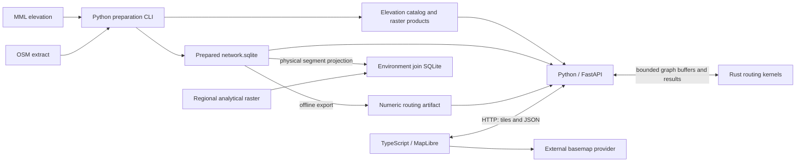

# Architecture

Runmap prepares local elevation and pedestrian-network data, then serves an
interactive map for terrain exploration and run planning. A Python application
owns preparation, storage, and HTTP delivery. Rust performs numerical routing
inside that process, and a TypeScript/MapLibre application renders the map.

## System view

Acquisition and dataset preparation are explicit CLI operations. Interactive
requests use prepared local coverage; panning does not acquire new source data.
Basemap tiles are a separate browser dependency and do not provide the network
used for routing. SQLite is embedded file storage, with no database server.

## Data preparation

**Shared OSM acquisition** can freeze a complete Geofabrik Finland PBF through
`sources/geofabrik.py`. `sources/pbf.py` streams that snapshot with a temporary
disk-backed location index, assembles complete area geometry, and publishes
regional environment features and reference-complete highway JSON. Both outputs
retain the same national snapshot identity. Existing environment and network
preparation consume those outputs independently; interactive servers do not read
the national PBF. Overpass remains an alternative source-acquisition path.

**Elevation processing** validates source rasters and records their provenance
in an elevation catalog. Coverage manifests pin the source versions for a region.
Smoothing and differentiation produce terrain tiles used by both map rendering
and path measurements. Source elevation is retained for contours and reprocessing.

**Network preparation** turns an OSM extract into a directed pedestrian graph,
then samples the prepared terrain along its paths. Physical segments own geometry;
directed arcs describe legal traversal. Policies, terrain-derived hill features,
display classifications, and coverage information are prepared over the complete
extract before runtime spatial selection. This preserves access and connectivity
semantics when a request loads only part of the network.

## Prepared storage

Regional environment preparation is independent of terrain and network topology.
`environment/regional.py` normalizes retained OSM objects, selects full geometries
through a spatial index, and writes haloed analytical blocks to one tiled TIFF.
`api/environment_tiles.py` reads bounded raster windows and caches rendered XYZ
PNGs. `web/src/environment-layers.ts` owns the main-map controls and legends;
these layers sit below roads and routes. This display path requires neither raw
source loading at request time nor a segment-feature join. Missing regional data
leaves terrain and routing available. Artifact and diagnostic contracts belong to
[prepared data](reference/prepared-data.md#regional-environment-bundles).

Environment pilot acquisition is independent of network preparation.
`sources/environment.py` uses optional OSMnx feature acquisition to retain raw
Overpass responses, assembled GeoJSON objects, and a provenance manifest. These
pilot artifacts feed `api/environment.py`, which serves a fixed published source
and its provenance to a separate MapLibre inspection page. That page shares the
neutral basemap and worker setup, but needs no terrain or path configuration.
Its independent source layers and click inspection retain overlapping evidence;
source data is not joined to routing. The
offline `environment/` package normalizes independent evidence memberships and
prepares metric raster channels, an evidence index, Web Mercator image previews,
and a source-bound manifest. `api/environment_rasters.py` serves those previews
and samples cells with nearby source evidence. The inspection frontend can load
source geometry without a prepared raster bundle; neither path invokes model
inference or network acquisition during map interaction. The
[environment design](environment-preferences.md) describes tiled map delivery,
proposed segment projection, costs/UI, and the independent OSM-only road-noise
experiment; [development](development.md#acquire-environment-pilot-data)
owns current acquisition commands and limitations.

The runtime uses three related artifact sets:

| Artifact | Responsibility |
| --- | --- |
| Elevation catalog, coverage manifests, and raster files | Identify source coverage and retain source/derived terrain products |
| Prepared network SQLite database | Serve geometry, measurements, policy evidence, inspection, and spatial queries |
| Numeric routing SQLite artifact | Supply compact graph buffers and prepared costs to native routing |
| Environment join SQLite artifact | Bind analytical raster cells to physical segment chainage for optional native route costs |

The network and numeric artifacts must describe the same dataset and prepared
models. Opening validates their identities. SQLite delivery reads selected data
without loading the source graph or measurement JSON. JSON artifacts remain the
input to export and an explicit compatibility backend.

Formats, publication rules, and identity contracts are described in
[prepared data](reference/prepared-data.md) and the
[numeric routing format](numeric-routing-format.md).

## API and analysis services

FastAPI owns the active datasets and service lifetimes. Terrain and path services
are independent: missing path artifacts leave terrain rendering available.
Terrain delivery reads raster products; path delivery queries the network database
for tiles, snapping, and inspection.

Distance exploration and run planning share the prepared network, eligibility
policies, snapping semantics, and numeric graph service. Exploration computes
forward distances that can be reused for distance shading. Planning
builds one-way or round-trip candidates with route-specific preferences.
Distance surfaces and candidate geometry are assembled in Python from search
results, while the browser handles presentation.

Runtime loading is bounded by the requested search area rather than total dataset
coverage. Unloaded connections and source-coverage edges are distinct: the service
can enlarge a working area without treating a cropped connection as a genuine dead
end. Planning expansion remains heuristic, so it does not guarantee a globally
best route outside the loaded area.

The [API reference](reference/api.md) covers endpoints, result contracts, search
limits, and request lifetimes. Mathematical definitions live in the
[terrain](reference/terrain-mathematics.md) and
[routing](reference/routing-mathematics.md) references.

## Routing backend boundaries

Native routing is an in-process Rust library exposed through PyO3. Python selects
prepared graph buffers and orchestrates requests; Rust owns graph traversal,
endpoint overlays, and cost evaluation during search. The same native graph
service supports planning and distance exploration.

When configured, Python validates the environment join against the network and
raster manifest, selects its intervals for the bounded graph, and attaches named
measurement/support records to the native graph. `environment_fields.py` owns
the Python field vocabulary and semantics. The PyO3 boundary resolves interval
and weight names into dense native arrays and returns diagnostics by field name.
Rust integrates the intervals in the arc cost callback;
the configured join is not queried during search.
The reference window loader can resolve the same join through network segment
identities. Its planner integrates those intervals with the shared pure function
and caches each directed arc's result for comparisons with native search.

Shared routing contracts, policies, geometry, and offline preparation live in
`routing/`. The Python search and cost implementations live in
`routing_reference/`, used for correctness comparisons and compatibility when a
numeric artifact is absent. Both packages ship together. Shared preparation and
native delivery do not depend on reference algorithms; API dispatch imports the
reference backend only when selected.

The separation allows native execution and reference validation to evolve against
the same prepared data and HTTP contracts. Module docstrings describe individual
modules; [development](development.md#native-integration-kernel) explains builds
and backend selection.

## Browser application

The browser owns map rendering, interaction state, and requests to the API.
A coordinator shares the start location and routing policy between path
exploration and planning. Feature controllers own their requests and displayed
results. Map-layer visibility is independent of planner activation.
The browser also serializes the selected candidate's ordered geometry to GPX
and downloads it locally; export requires no server endpoint or profile request.

Route elevation is a separate on-demand read of ordered traversal geometry and
manifest-pinned smoothed height COGs. It does not execute a routing search or
depend on hill preferences. The browser profile controller owns cancellation,
a bounded result cache, chart exploration, and the map location marker. Segment
click inspection is removed; path controllers own layers and distance starts.

The frontend cancels superseded fetches and rejects late responses so old work
cannot replace the current selection. Server computation has its own deadlines;
browser cancellation does not immediately stop a running search. Controls and
current user-visible behavior are documented in the [guide](guide.md).

## Ownership and deployment

Prepared datasets are read-only during path delivery. Dataset services retain
bounded shared caches and database connections. Each search owns its endpoint
overlay, cost context, and mutable traversal state, allowing concurrent searches
over immutable graph data.

Exploration snapshots and caches are process-local. Native snapshots retain
independent search results and survive graph-cache eviction. A snapshot cannot be
looked up in another API worker or after a restart; the current deployment uses
one worker. Connection leases, admission limits, and deadlines bound active work.
Missing terrain derivatives can still be computed synchronously on a request.

Vite serves the frontend during development; FastAPI can serve its built assets.
Configuration and operational constraints belong in [development](development.md).
Performance targets and remaining work belong in the
[latency reference](100ms-routing-architecture.md) and [roadmap](roadmap.md).

## Source map

Python locations below are relative to `src/runmap/`.

| Component | Location |
| --- | --- |
| Acquisition and region definitions | `sources/`, `regions.py`, `cli.py` |
| Elevation storage and terrain calculations | `elevation/`, `terrain/` |
| Network preparation and artifact access | `paths/` |
| Shared routing and native adapters | `routing/`, `rust/src/` |
| Python reference algorithms | `routing_reference/` |
| HTTP contracts and dataset services | `api/` |
| Map rendering and interaction | `web/src/` |
| Reproduction and performance experiments | `experiments/` |

The turnaround-region controller reuses exploration snapshots and requests advisory
GeoJSON independently of route generation. `api/turnaround.py` adds a reverse
native distance search, caches paired network samples in the shell service, and
contours a cubic estimate and empirical uncertainty from `routing/turnaround.py`.
The offline calibration exporter produces the compact coefficient/residual data
in `routing/turnaround_calibration.py`; no fitting library is needed at request
time. The layer shares shell worker, memory, coverage, and deadline limits.
The [distance-shell guide](distance-shells.md#estimated-turnaround-region)
and [routing reference](reference/routing-mathematics.md#turnaround-region-estimate)
define the display and estimator contracts.
