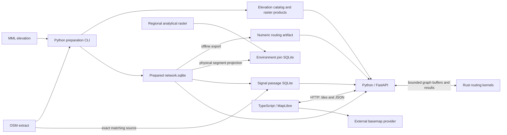

# Architecture

Runmap prepares local elevation and pedestrian-network data, then serves an
interactive map for terrain exploration and run planning. A Python application
owns preparation, storage, and HTTP delivery. A compiled Rust library searches
for routes inside the Python process. A TypeScript application displays the results using MapLibre in the browser.

A typical request follows a simple path: the browser sends a location and
preferences, Python loads the relevant prepared data, Rust searches it, and
Python returns a route for the browser to draw. The sections below follow that
data from preparation to display. The [glossary](glossary.md) explains terms such
as node, segment, arc, numeric, and native.

## System view

Data is downloaded and prepared with command-line tools before the server uses
it. Map requests read local prepared files. Panning does not download new source
data.
Basemap tiles are a separate browser dependency and do not provide the network
used for routing. SQLite is embedded file storage, with no database server.

## Data preparation

**Shared OSM acquisition** starts with a fixed Geofabrik Finland PBF snapshot.
`sources/geofabrik.py` downloads it, and `sources/pbf.py` reads it using a temporary
on-disk location index. Preparation produces regional environment features and
highway JSON with all referenced objects included. Both outputs record the same
national source version. Environment and network preparation then use those
outputs separately. The interactive server does not read the national PBF.
Overpass is another way to acquire source data.

**Elevation processing** validates source rasters and records their provenance
in an elevation catalog. Coverage manifests pin the source versions for a region.
Smoothing and differentiation produce terrain tiles used by both map rendering
and path measurements. Source elevation is retained for contours and reprocessing.

**Network preparation** turns an OSM extract into a directed pedestrian graph,
then samples the prepared terrain along its paths. Each physical segment stores
the line of a path; directed arcs describe travel along it. Access rules, hill measurements, display
categories, and coverage information are prepared for the full extract. A request
can then load a smaller area while keeping the prepared access and connection
rules.

## Prepared storage

Traffic-light preparation reads crossing evidence for the full network.
`paths/signal_preparation.py` decides where a route should count a crossing:
at a gate along a segment or during a particular movement through a junction.
`paths/signals.py` writes these records to `signals.sqlite`, with metadata tying
it to the source network. Requests load records for selected segments while
keeping the crossing interpretation prepared for the full network.

With Signals On, Rust search remembers the incoming movement so it can charge
crossings correctly. With Signals Off, it uses the faster node-only search.
The Python reference implements the same passage rules with separate search
records. See [traffic-light avoidance](traffic-light-avoidance.md).

The map's signal points follow a separate path. `api/signals.py` queries source
points inside the viewport from the sidecar's spatial index. The browser control
in `web/src/traffic-lights.ts` lets users inspect their source tags, distinguishes
vehicle-light evidence from explicit pedestrian evidence, and ignores outdated
responses. This does not require environment rasters or raw OSM reads at request
time. Point counts and routing passage counts describe different things.

Regional environment preparation is separate from terrain and network connections.
`environment/regional.py` selects retained OSM objects through a spatial index and
writes one tiled TIFF. Each processing block includes surrounding data so values
near block edges can use nearby features. `api/environment_tiles.py` reads the
requested raster area and caches rendered map tiles. The controls and legends
live in `web/src/environment-layers.ts`; the layers draw below roads and routes.
They need no raw source loading or routing segment join during map requests.
Terrain and routing remain available if regional environment data is missing.
See [prepared data](reference/prepared-data.md#regional-environment-bundles) for
file and diagnostic rules.

A separate environment pilot supports source inspection. `sources/environment.py`
can acquire OSM features through OSMnx and Overpass, retaining raw responses,
assembled GeoJSON, and a manifest recording their origin. `api/environment.py`
serves one published source to a separate MapLibre inspection page. Its layers
remain independent, so overlapping evidence can be inspected without attaching
it to the routing network.

Offline tools in `environment/` also turn source evidence into metric raster
values, an evidence index, image previews, and a matching manifest.
`api/environment_rasters.py` serves previews and samples values with nearby source
evidence. The inspection page can show source geometry without a raster bundle.
Neither inspection path downloads data or runs model inference during interaction.
The [environment design](environment-preferences.md) describes fields, map delivery,
route costs, and the separate proposed road-noise learning experiment.
[Development](development.md#acquire-environment-pilot-data) covers acquisition
commands and limitations.

The server reads these related prepared files:

| Prepared files | Purpose |
| --- | --- |
| Elevation catalog, coverage manifests, and raster files | Identify source coverage and retain source/derived terrain products |
| Prepared network SQLite database | Serve geometry, measurements, policy evidence, inspection, and spatial queries |
| Numeric routing SQLite database | Supply compact graph arrays for Rust search |
| Environment join SQLite database | Store environment values along physical segments for optional route costs |
| Signal sidecar and optional packed routing inputs | Store crossing records and reusable hill, environment, and signal data |

The network and numeric artifacts must describe the same dataset and prepared
models. Opening validates their identities. SQLite delivery reads selected data
without loading the source graph or measurement JSON. JSON artifacts remain the
input to export and an explicit compatibility backend.

Formats, publication rules, and identity contracts are described in
[prepared data](reference/prepared-data.md) and the
[numeric routing format](numeric-routing-format.md).

## API and analysis services

FastAPI owns the active datasets and service lifetimes. Terrain and path services
are independent: missing path artifacts leave terrain rendering available.
Terrain delivery reads raster products; path delivery queries the network database
for tiles, snapping, and inspection.

Distance exploration and run planning use the same prepared network, access
rules, location-snapping behavior, and numeric graph service. Exploration computes
forward distances that can be reused for distance shading. Planning
builds one-way or round-trip candidates with route-specific preferences.
Distance surfaces and candidate geometry are assembled in Python from search
results, while the browser handles presentation.

Requests load a limited search area rather than the whole prepared dataset. The
service distinguishes a connection outside that area from the edge of the source
dataset. It can then enlarge the search area without treating an unloaded path as
a real dead end. Expansion uses heuristic checks, so a better route may still
exist outside the loaded area.

The [API reference](reference/api.md) covers endpoints, result contracts, search
limits, and request lifetimes. Mathematical definitions live in the
[terrain](reference/terrain-mathematics.md) and
[routing](reference/routing-mathematics.md) references.

## Routing backend boundaries

Python and Rust run in the same server process. Python chooses the search area,
loads prepared files, and builds the response. Rust searches the graph and
calculates the costs of following its paths. PyO3 connects the two languages.
Planning and distance exploration use the same Rust graph service.

### Reusing graph data

The numeric data service keeps two kinds of cache. One reuses a graph already
assembled for exactly the same area. The other, in `routing/numeric_store.py`,
keeps independently loadable graph chunks within a byte budget. When a new area
overlaps an earlier one, it can reuse those chunks and load only the missing ones.
Each store belongs to the dataset version opened by the service.

The chunks contain read-only data and validated connection indexes. A graph keeps
references to the chunks it uses, so cache eviction or database shutdown does not
invalidate an active search. For each new area, the service still merges node
lookups and marks selected paths and connections that continue outside the area.
A shared preparation lock still makes unrelated loads wait for one another.
Concurrent searches have separate state. See [development](development.md) for
cache budgets and configuration.

### Prepared routing inputs

Hills, environment, and traffic-light signals provide observations prepared before
a request. The request's preference weights turn these observations into costs.
The original rasters and source evidence remain available separately for map
layers and inspection.

| Input | Prepared data | When more detail is needed |
| --- | --- | --- |
| Hills | Totals for each travel direction, with terrain-quality information | When a route starts or ends partway along a segment |
| Environment | Values and support flags over intervals along a segment | When integrating partial traversals or reporting lengths with unknown values |
| Signals | Crossing gates and incoming-to-outgoing movement records | When counting passages through crossings, including between route legs |

The numeric data service opens the sources and checks that they match the active
dataset. `routing/prepared_inputs.py` selects the input groups, called channels,
needed by the request. Hills use complete-segment totals and load partial-segment
detail only when enabled. Environment and signals are attached for search only
when their preferences are enabled. Distance exploration loads no optional search
channels.

With environment preferences Off, the server still reports environment
observations. It reads only the returned route's data after choosing the final
search area, using the same Rust calculation as search. With Signals Off, passage
counts remain absent.

A cached graph is identified by its bounds and loaded channels. Changing a weight
within an enabled channel reuses the observations. Partial hill detail belongs to
the prepared request graph; `NumericEndpoint` contains only a location. Reported
source availability describes the configured, validated sources, even when a
request does not load them. Shape and route-reuse costs depend on the request and
remain part of search.

### Storing preference data separately

Optional `routing-inputs-v1.sqlite` and compressed `routing-inputs-v2.sqlite` files
store all three channels by graph chunk. `routing/input_store.py` caches validated
Rust input chunks and partial hill bytes within a byte budget. Overlapping graphs
share environment interval arrays and hill-total arrays. Active graphs keep their
input data alive after cache eviction.

Rust reads hill totals directly by chunk and segment position. Packed loading
removes the old hill columns from topology buffers before caching them. A
conversion to topology format 3 also removes those columns and the separate hill
interval table from disk. The paired input file then holds all routing hill data.
Partial hill detail is loaded by segment, avoiding a read for the whole area.
Older datasets still load their sources through the same preparation interface.
See the [numeric format reference](numeric-routing-format.md#packed-routing-inputs)
for file versions, layouts, and matching rules.

### Searching and describing the selected path

During search, Rust calculates the total cost needed to compare paths. It leaves
full diagnostic breakdowns until a path has been selected. Search predecessors
store compact references to base arcs or overlay edges; Rust reconstructs the
full edge records only for the chosen path. Shape calculations belong to the
request. Complete-segment shape calculations use the original geometry without
creating clipped copies.

Python checks that configured environment data matches the network and raster
manifest. With packed inputs, Rust decodes environment intervals directly. With
older inputs, Python passes named values and support records for the selected
area. `environment_fields.py` defines the field names and meanings. The language
interface turns preference names into indexed Rust arrays and returns diagnostics
by field name. All required intervals are in memory before search; search does
not query the environment database for each arc.

The Python reference loader can read the same environment data by segment ID.
It uses the shared Python integration function and caches each directed arc's
result for comparisons with Rust.

### Keeping a Python reference

`routing/` holds shared contracts, policies, geometry, preparation code, and native
adapters. `routing_reference/` holds the Python search and cost implementation.
The reference implementation supports correctness comparisons and compatibility
when a numeric artifact is absent. Both packages ship together, but the API loads
the reference backend only when selected. Shared preparation does not depend on
its search algorithms.

This lets the two implementations evolve while using the same prepared data and
HTTP contracts. Module docstrings explain individual modules;
[development](development.md#native-integration-kernel) covers builds and backend
selection.

## Browser application

The browser owns map rendering, interaction state, and requests to the API.
A coordinator shares the start location and routing policy between path
exploration and planning. Feature controllers own their requests and displayed
results. Map-layer visibility is independent of planner activation.
The browser requests the selected candidate's route profile and serializes its
ordered sample coordinates and available elevations to GPX for local download.
Profile sampling retains geometry vertices and adds terrain samples along edges.

Route elevation is a separate on-demand read of ordered traversal geometry and
manifest-pinned smoothed height COGs. It does not execute a routing search or
depend on hill preferences. The browser profile controller owns cancellation,
a bounded result cache, chart exploration, and the map location marker. Segment
click inspection is removed; path controllers own layers and distance starts.

The frontend cancels superseded fetches and rejects late responses so old work
cannot replace the current selection. Server computation has its own deadlines;
browser cancellation does not immediately stop a running search. Controls and
current user-visible behavior are documented in the [guide](guide.md).

## Ownership and deployment

The server reads prepared datasets without changing them. Dataset services keep
shared caches and database connections. Each search has its own temporary endpoint
connections, cost settings, and search records. Searches can therefore run
concurrently over the same read-only graph data.

Exploration snapshots and caches are process-local. Native snapshots retain
independent search results and survive graph-cache eviction. A snapshot cannot be
looked up in another API worker or after a restart; the current deployment uses
one worker. Connection leases, admission limits, and deadlines bound active work.
Missing terrain derivatives can still be computed synchronously on a request.

Vite serves the frontend during development; FastAPI can serve its built assets.
Configuration and operational constraints belong in [development](development.md).
Performance targets and remaining work belong in the
[latency reference](100ms-routing-architecture.md) and [roadmap](roadmap.md).

## Optional local Suunto export

`web/src/route-export.ts` shares elevation preparation between GPX download and
the Suunto dialog in `web/src/suunto.ts`. Both use the existing GPX serializer.
`api/suunto.py` owns the optional loopback-only integration, durable operation
records, per-operation file locks, and bounded subprocess execution.
`integrations/suunto/runner.mjs` loads a separately installed TypeScript importer;
that importer owns credential login, GPX validation, protobuf encoding, response
verification, and creation/selection receipts. It uses `suunto-api-wrapper` for
authentication and transport. The Suunto app owns physical watch sync.

Operation records and receipts live outside routing datasets and survive API
restarts. A client-generated UUID identifies one immutable export payload; repeated
creation submissions reuse its result. Creation uncertainty requires manual
library inspection; watch selection can be explicitly retried from a verified
creation receipt. Credentials and raw upstream errors are never returned to the
browser. See [setup](development.md#local-suunto-integration) and the
[API contract](reference/api.md#local-suunto-export).

## Source map

Python locations below are relative to `src/runmap/`.

| Component | Location |
| --- | --- |
| Acquisition and region definitions | `sources/`, `regions.py`, `cli.py` |
| Elevation storage and terrain calculations | `elevation/`, `terrain/` |
| Network preparation and artifact access | `paths/` |
| Shared routing and native adapters | `routing/`, `rust/src/` |
| Python reference algorithms | `routing_reference/` |
| HTTP contracts and dataset services | `api/` |
| Map rendering and interaction | `web/src/` |
| Reproduction and performance experiments | `experiments/` |

The turnaround-region controller reuses exploration snapshots and requests advisory
GeoJSON independently of route generation. `api/turnaround.py` adds a reverse
native distance search, caches paired network samples in the shell service, and
contours a cubic estimate and empirical uncertainty from `routing/turnaround.py`.
The offline calibration exporter produces the compact coefficient/residual data
in `routing/turnaround_calibration.py`; no fitting library is needed at request
time. The layer shares shell worker, memory, coverage, and deadline limits.
The [distance-shell guide](distance-shells.md#estimated-turnaround-region)
and [routing reference](reference/routing-mathematics.md#turnaround-region-estimate)
define the display and estimator contracts.
