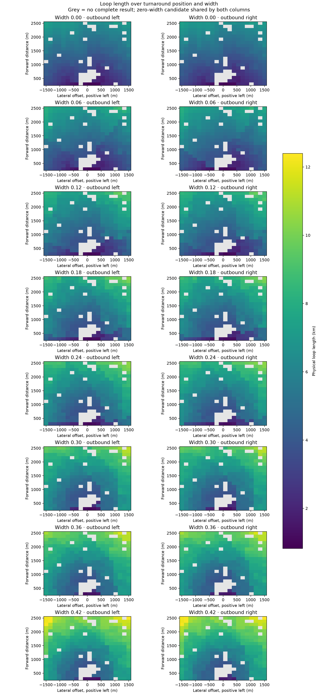
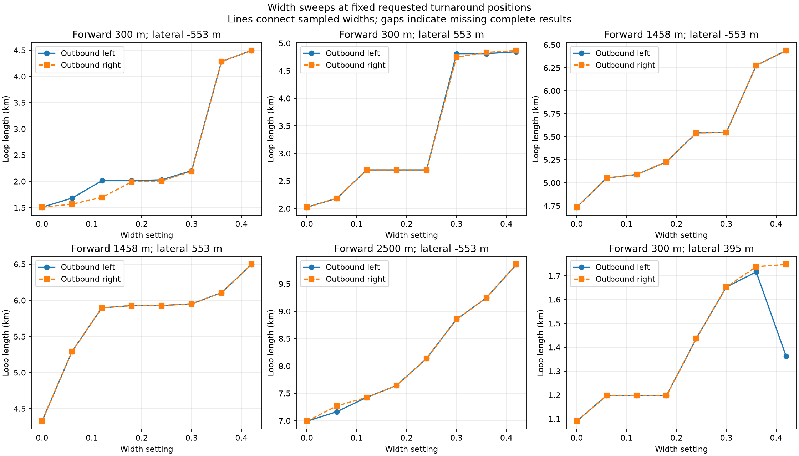
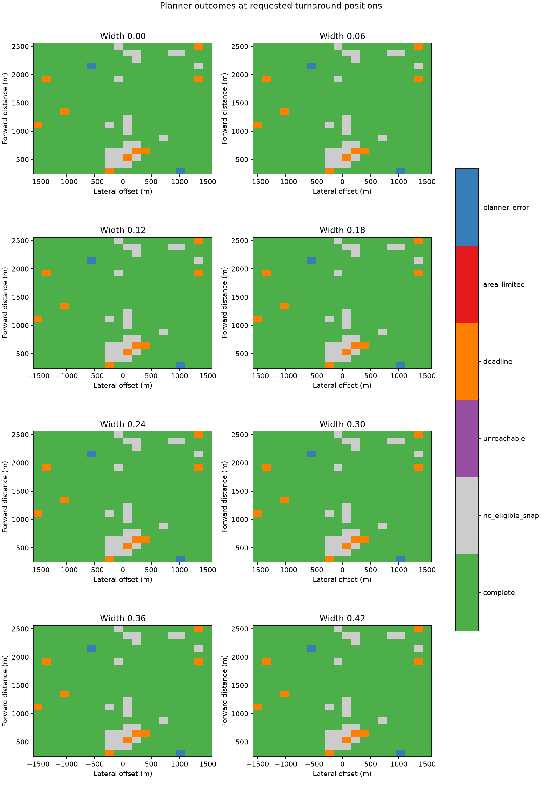
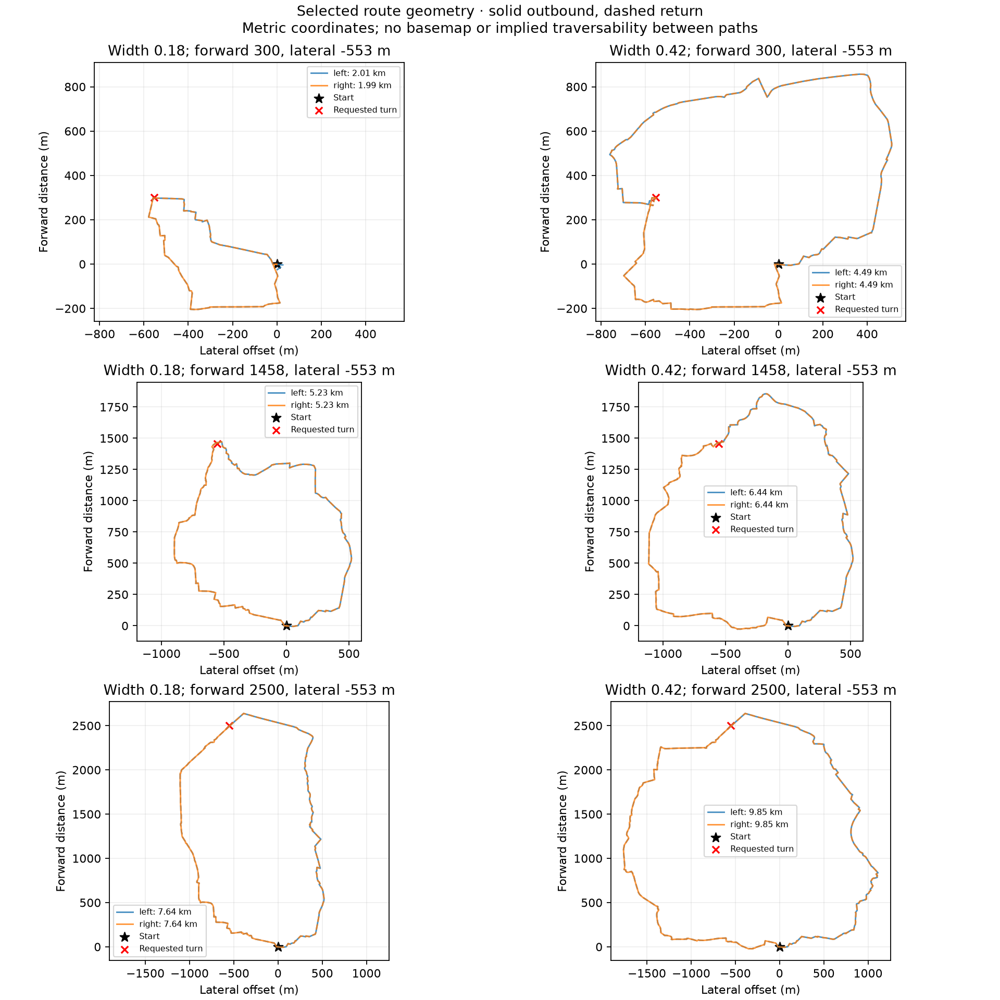

# Loop-length parameter grid — 2026-10-28

This experiment samples the existing round-trip planner before choosing a length
proxy or an automatic turnaround-search method. It records physical route length
over a three-dimensional grid: two turnaround coordinates and loop width. No
surrogate model or optimizer was fitted. Current commands and output contracts
are in the [development guide](../../development.md#loop-length-parameter-grid);
remaining work belongs in the [roadmap](../../roadmap.md#loop-recommendation-experiments).

## Configuration and reproduction

```sh
uv run --extra web --extra experiments python -m runmap.experiments.loop_length_grid \
  data/paths/prepared/helsinki-capital-area/network.sqlite \
  artifacts/loop-length-grid/leppavaara-north-2026-10-28-bounded \
  --home 24.795 60.216 --bearing 0 \
  --forward 300 2500 --lateral -1500 1500 --grid 20 20 \
  --widths 0 0.06 0.12 0.18 0.24 0.30 0.36 0.42 --timeout 3
```

Use a fresh output directory when reproducing the run. The start is near
Leppävaara. Coordinates are metres in EPSG:3067, with forward along projected
north and positive lateral distance to the left (west). This is a rectangle,
not a restricted angular sector. Spatial spacing is approximately 115.8 m forward
and 157.9 m laterally. The even-sized lateral grid does not sample zero exactly.

Preferences are fixed: hills Off, all surfaces, stairs avoided, 50 m snapping
radius, and application-default shape settings apart from width. Width is the
dimensionless `avoidance_ratio`, not a geometric measurement. The run explicitly
uses a 3 s planner deadline; the experiment CLI default remains 15 s. Search-area
limits retain their production defaults. Each spatial point is evaluated at all
eight widths before moving to the next point, sharing bounded native working sets.

Dataset identity:
`2f8b220e40a1cf1c40b733db19b1be939e7e93ca064e52c3c110f29f824034b5`.
The cost composition is `distance-preferences-v1`; prepared hill metadata names
`minetti-excess-uphill-preference-v4`, although hill costs are disabled in this
run. The [measurement record](54-loop-length-grid.json) preserves complete model
and dataset metadata, source revision/working-tree identity, sampling-source
digest, plotting-source digest, machine, limits, and failing inputs. The source
revision was `769d5db4762a6ad5f14d8d37b4a0f213eeda086f` with uncommitted experiment
code. Machine: macOS 26.6.2 arm64, Python 3.14.6.

## Results

| Measurement | Observation |
| --- | ---: |
| Spatial positions × widths | 400 × 8 = 3,200 evaluations |
| Complete evaluations | 2,920 (91.25%) |
| Positions complete at all widths | 365 / 400 |
| Complete candidate loops | 5,475 |
| No eligible snap | 192 evaluations / 24 positions |
| Deadline | 72 evaluations / 9 positions |
| Planner validation error | 16 evaluations / 2 positions |
| Physical loop-length range | 820.54–12,397.06 m |
| Spatial-neighbor length difference, median / p95 | 235.50 / 949.95 m |
| Width increases reducing length by more than 1 m | 15 / 5,110 adjacent comparisons |
| Evaluation wall time, median / p95 | 133.65 / 398.11 ms |
| Sampling wall time | 704.07 s |

Both outbound side assignments are retained, giving two candidates per completed
nonzero-width evaluation and one at zero width. The latter is displayed in both
columns as a common baseline; it is counted once in candidate totals. Only
complete evaluations contribute to length statistics. Deadline results are
censored observations, not evidence of unreachability. Timings include in-process
snapping, preparation, routing, and response construction. They exclude HTTP,
browser work, serialization, and plotting and are not an isolated latency benchmark.

### Length surfaces



There is a broad spatial trend and an overall increase with width, alongside
local changes in selected paths. Grey cells are missing complete observations.
The neighbor-difference statistics pool forward and lateral neighbors and both
side assignments at the stated grid spacing. They measure finite differences,
not proxy prediction error or proof of mathematical discontinuity.

### Width sweeps



Several sweeps show plateaus followed by large changes. Length is not strictly
increasing with width: at forward 300 m and lateral 394.74 m, the outbound-left
candidate drops from 1,715.40 m at width 0.36 to 1,361.97 m at width 0.42, a
353.44 m decrease. These are physical lengths of routes selected by the existing
penalized, sequential two-leg planner. A future search must account for this
observed non-monotonicity. Connected plot markers do not imply fitted interpolation
between sampled widths.

### Outcomes and geometry



All widths share the same evaluation status at each position in this run. This
does not establish that feasibility is generally independent of width. No
completed evaluation reported source-coverage limitation, and none returned
`unreachable` or `area_limited` under the 3 s deadline.

The two error positions consistently raise
`ValueError: Endpoint offset is outside the selected segment`. They are recorded
as `planner_error`, with a null response and no invented distance. The measurement
record contains all 16 failing parameter combinations. Resolving the validation
failure remains separate work; its underlying cause was not established here.



Route examples compare width 0.18 and 0.42 with common limits within each pair.
They show how the same requested turnaround can produce substantially different
loops. Solid lines are outbound, dashed lines return; the two colors identify
side assignments and can overlap. These are metric geometry plots without a
basemap.

## Artifacts and validation

The archived JSON and four PNGs beside this report preserve the measurements and
figures. Full compressed responses, CSV observations, manifest, and PNG/SVG plots
remain in the ignored local directory
`artifacts/loop-length-grid/leppavaara-north-2026-10-28-bounded/`. The archived
record includes the compressed sample file's size and SHA-256 for identification.
The raw responses retain snapped positions, traversals, route geometry, costs,
repeated distance, and search diagnostics; the CSV also contains ordered-route
fingerprints for later analysis.

Four focused unit tests pass, covering metric grid orientation, invalid settings,
saved candidate identity, missing/partial/error result masking, the shared
zero-width baseline, and rejection of unfinished runs. A 27-evaluation pilot
also completed and generated plots. All four full-grid figures were visually
inspected. This evidence covers one start and one preference preset; it does not
establish surveyed route quality, surrogate accuracy, or generalization. The
next modeling experiment should retain a held-out evaluation set and compare
target-length success under equal routing-call and wall-clock budgets.
