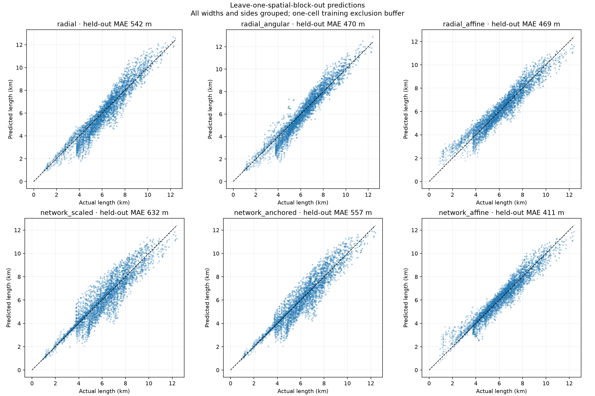
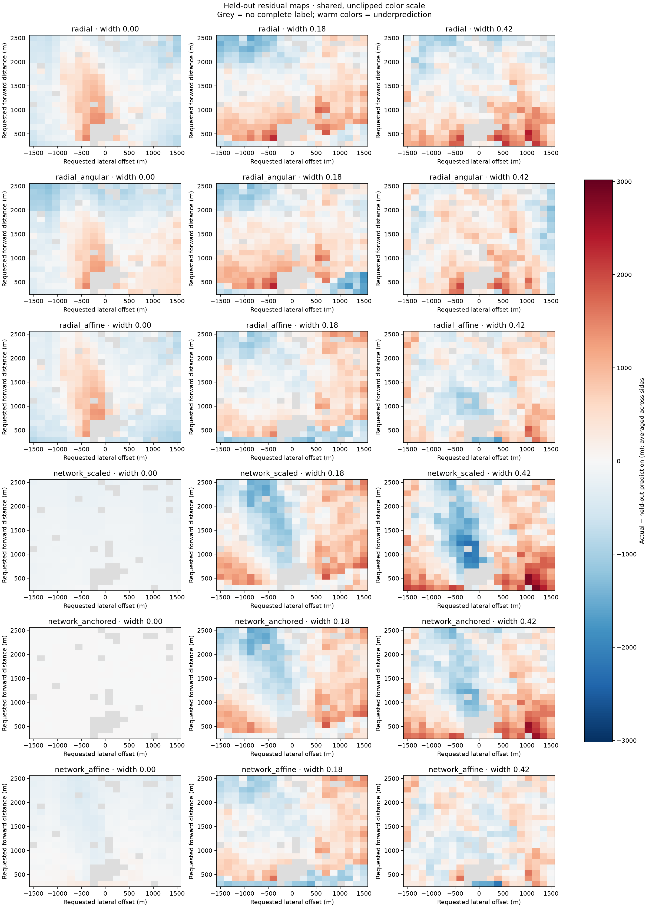
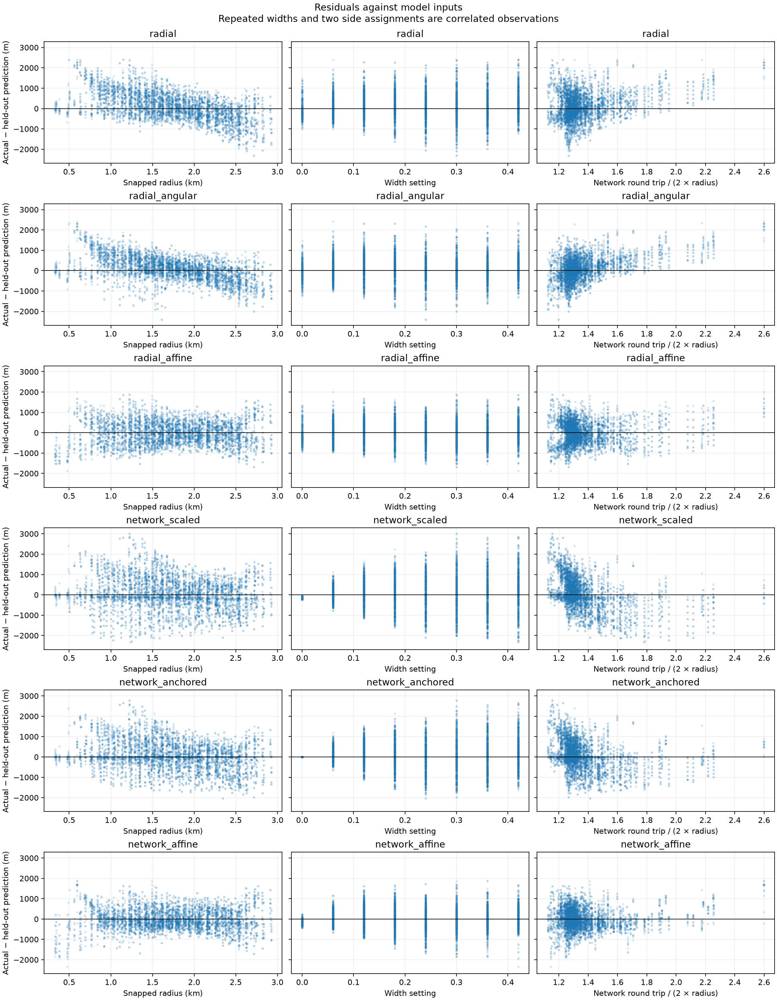
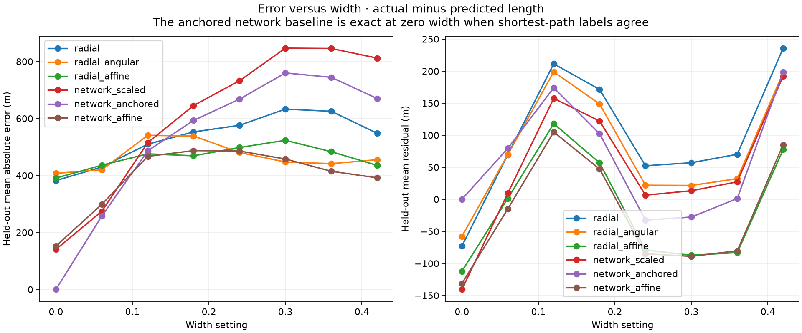

# Loop-length polynomial baselines — 2026-10-28

The [first grid](54-loop-length-grid.md) contains 5,475 completed candidate loops
at 365 turnaround positions and eight widths. This experiment fits low-order
means and examines their residuals before adding a probabilistic local model.
The best tested mean combines an affine radial trend with network-detour
interactions: buffered spatial-holdout MAE is **410.51 m**, versus **542.00 m**
for the original proportional radial polynomial. Substantial spatial structure
remains in the errors.

Current commands and output contracts belong in the
[development guide](../../development.md#loop-length-baseline-fits). The
[measurement record](55-loop-length-baselines.json) preserves coefficients,
all metrics, outliers, source identity, input hash, and feature timings. These
are exploratory comparisons on one start and preference preset, not results
on an untouched final test set.

## Models and validation

Let width be $w$, normalized width $q=w/0.18$, snapped projected separation $r$,
and unpenalized directed network round-trip distance
$b=d(H,T)+d(T,H)$. Define $R=r/1000$ and $D=(b-2r)/1000$. Distances $r,b$ are
in metres; $R,D$ are numerical kilometre features. $P_2,A_2,B_2,C_2$ below
denote independently fitted quadratic polynomials in $q$.

| Model | Mean | Parameters |
| --- | --- | ---: |
| `radial` | $rP_2(q)$ | 3 |
| `radial_angular` | $rP_2(q)+uA_2(q)+vB_2(q)$, snapped forward/lateral $u,v$ | 9 |
| `radial_affine` | $A_2(q)+RB_2(q)$ | 6 |
| `network_scaled` | $bP_2(q)$ | 3 |
| `network_anchored` | $b+r(c_1q+c_2q^2)$ | 2 |
| `network_affine` | $A_2(q)+RB_2(q)+DC_2(q)$ | 9 |

Ordinary least squares gives a shared mean across both side assignments. No
monotonicity, positivity, or origin constraints are imposed except for the
explicit basis/offset of each model. Each measured candidate receives equal
weight, so nonzero widths have two observations and zero width has one.

Validation leaves out each of sixteen 5 × 5 spatial blocks in turn. All widths
and both sides at each test position stay out of training. A one-cell buffer
also excludes neighboring training positions, approximately 116 m forward and
158 m laterally. Every observation receives one held-out prediction. Full-data
coefficients and training metrics are saved separately. The comparison does
not test prediction at unseen widths, starts, or preferences.

Network features come from two fresh Dijkstra searches under the grid's original
surface/stair policy. Return-distance interpolation reverses segment direction
permissions. The 6,764 m budget is the longest observed feasible leg plus 100 m;
it selects computational extent, not the numerical feature values. A projected
lower bound determines the loading window, and neither search reached a loaded
frontier. The independently computed $b$ agrees with every zero-width loop to
within $4\times10^{-12}$ m. No held-out loop length was substituted for $b$.

## Prediction results

All figures below use held-out predictions unless explicitly stated otherwise.
Residual means actual minus predicted physical length.

| Model | Training MAE | Held-out MAE | Held-out RMSE | p95 absolute error | Held-out $R^2$ |
| --- | ---: | ---: | ---: | ---: | ---: |
| Radial | 510 m | 542 m | 698 m | 1,436 m | 0.874 |
| Radial + angle | 423 m | 470 m | 610 m | 1,234 m | 0.904 |
| Affine radial | 427 m | 469 m | 574 m | 1,096 m | 0.915 |
| Scaled network | 590 m | 632 m | 823 m | 1,641 m | 0.825 |
| Anchored network | 522 m | 557 m | 734 m | 1,466 m | 0.861 |
| Affine radial + network detour | 369 m | **411 m** | **527 m** | **1,060 m** | **0.928** |



The affine network model improves MAE by 24.3% over the original radial model
and 12.4% over affine radial alone. Excluding zero-width observations, its MAE
is 428.95 m versus 474.45 m for affine radial, so the improvement is not solely
from near-exact zero-width features. It places 38.8% of all candidate predictions
within 250 m, and 46.5% within 5% of measured length. It is a useful global mean,
but these results do not establish sufficient precision for target-length search.

The full-data fitted mean is

$$
\widehat L=A(q)+RB(q)+DC(q),
$$

with coefficients producing length in metres:

| Polynomial | Constant | $q$ | $q^2$ |
| --- | ---: | ---: | ---: |
| $A$ | −306.345935 | 1,826.516936 | −364.125084 |
| $B$ | 2,067.132092 | 672.444579 | 5.677000 |
| $C$ | 1,265.071900 | −1,547.978462 | 316.736166 |

These coefficients describe the sampled region, not a physical law. In
particular, the unconstrained affine model must not be extrapolated toward
zero separation or outside the sampled width range.

## What the residuals show



**Local structure remains.** For the affine network model, adjacent spatial
residual correlation is 0.638 in the full-data fit and 0.691 in held-out
predictions. Pairs are compared within the same width and side assignment.
The maps show coherent patches rather than independent scatter. Held-out
correlation can also reflect changes between fold-specific fits; the full-data
correlation confirms that the pattern is not solely a fold-boundary effect.

**The original mean was too restrictive.** Its residuals trend downward with
radius. Allowing a width-dependent radial intercept reduces that trend and
improves validation before adding any local model. Thus not every large
residual should be attributed to a barrier discontinuity.



**A shortest-path detour is informative but insufficient by itself.** Simply
multiplying $b$ by a width polynomial performs worse than the radial baseline.
Adding detour as a separate feature alongside an affine radial trend performs
better. This is evidence for interactions between network accessibility and
loop shape; it does not establish a causal explanation for an individual road
or railway crossing.

**Width still has systematic bias.** The affine network model's mean held-out
residual is about +105 m at width 0.12, −80 to −89 m at widths 0.24–0.36, and
+85 m at width 0.42. Overall bias is only −13 m, which hides these per-width
patterns. A quadratic width mean does not explain all observed transitions.



**Local failures can be large.** The largest held-out error for the affine
network model occurs at requested forward 300 m, lateral 394.74 m, width 0.42:
it predicts 3,709.42 m for the 1,361.97 m outbound-left candidate, overpredicting
by 2,347.45 m. This is the location with the width-related route-length drop
identified in the first grid. Specific barrier attribution requires inspecting
the network and the selected routes on both sides of a transition; the residual
maps alone do not establish it.

**Side assignments sometimes need separate predictions.** Across 2,555 paired
evaluations, their length difference has median approximately zero, p95 219.97 m,
and maximum 2,097.63 m. A shared mean cannot represent both values at such a
point. Side-specific residual models or a categorical side input should be
included in the next experiment rather than treating that difference as noise.

## Reproduction and limits

```sh
uv run --extra web --extra experiments python -m runmap.experiments.fit_loop_length \
  artifacts/loop-length-grid/leppavaara-north-2026-10-28-bounded \
  data/paths/prepared/helsinki-capital-area/network.sqlite \
  artifacts/loop-length-fit/leppavaara-north-2026-10-28-final \
  --block-size 5 --buffer 1
```

Use a new output directory when reproducing. The local analysis directory holds
per-candidate predictions, all network features, full report JSON, and PNG/SVG
figures. The JSON and four PNGs beside this report preserve the dated evidence.
Dataset/model identity and the SHA-256 of the original raw samples are embedded
in the measurement record. Failed grid evaluations have no invented training
labels; results are conditional on the 365 positions with complete loops.

The feature computation loaded 150,436 nodes and 91.0 MB of numeric payload
buffers. In the final recorded run, preparation took approximately 1.02 s and
the two searches about 0.25 s combined, with total feature construction about
1.44 s. These are offline observations; they do not establish interactive
latency. Online use must account for this per-start cost and its reuse across
candidate queries. Timing samples are in the JSON.

Nine focused tests pass, including exact recovery of synthetic polynomial
functions under spatial holdout, grouped/buffered splits, exact zero-width
anchoring, and directed return interpolation. All four final figures were
visually inspected. The next experiment should test a side-aware local residual
model against these means, evaluate uncertainty near transitions, and retain
held-out spatial blocks. A new final test set or another start is needed before
claiming generalization after this exploratory model comparison.
