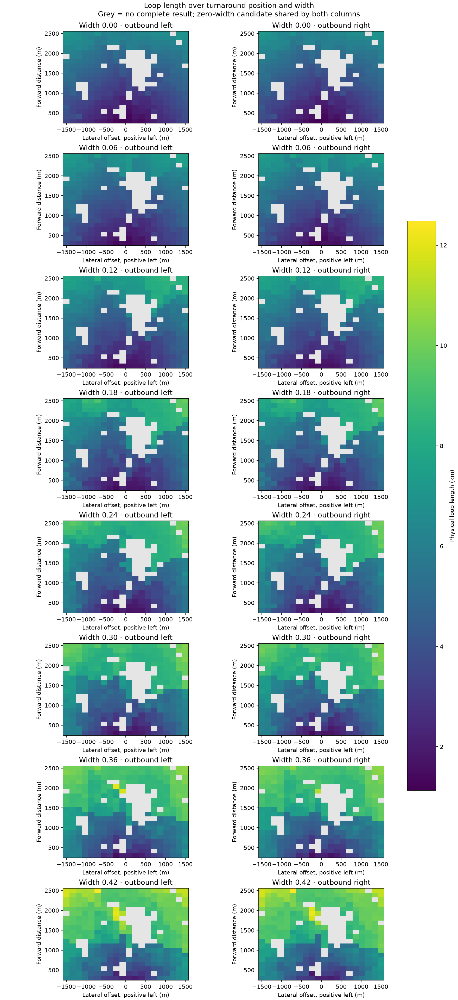
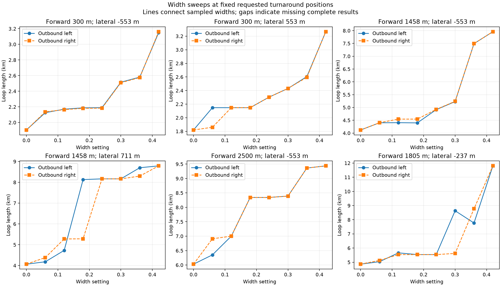
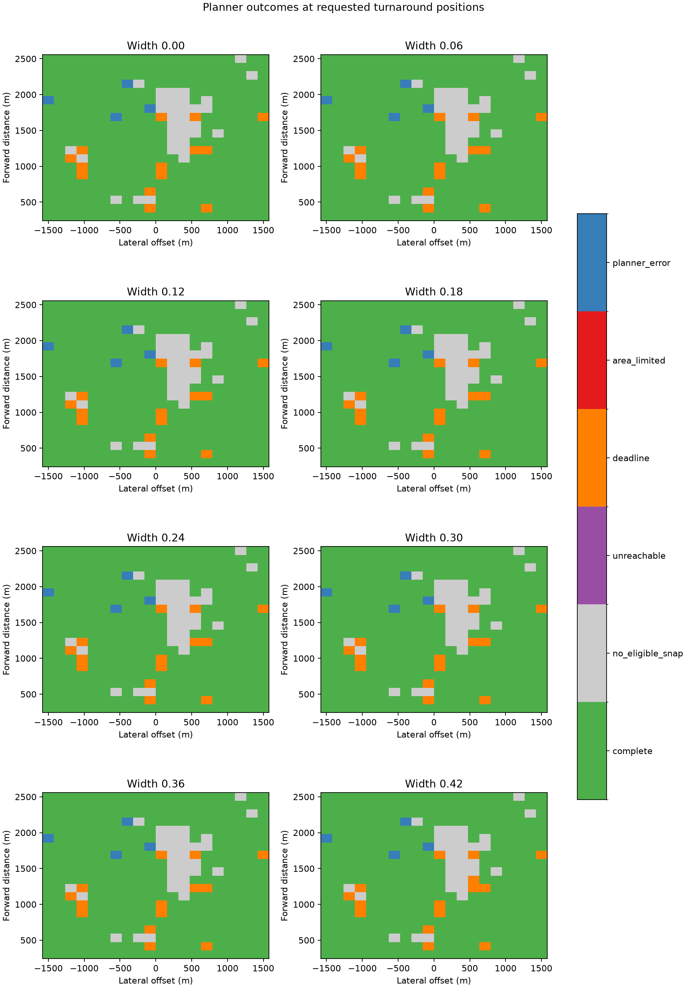
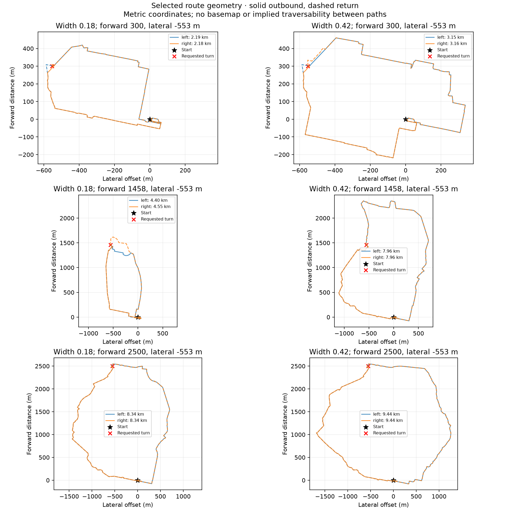
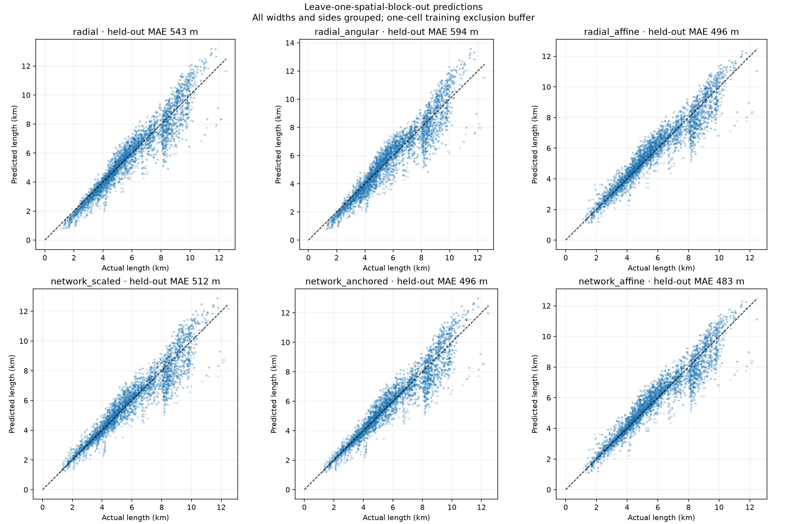
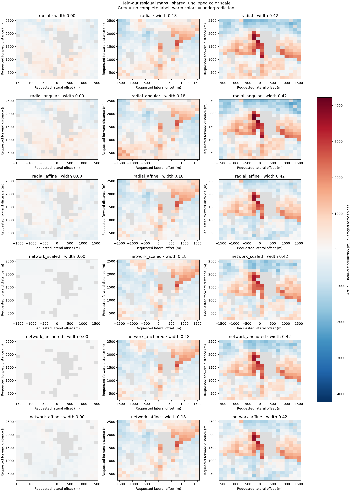
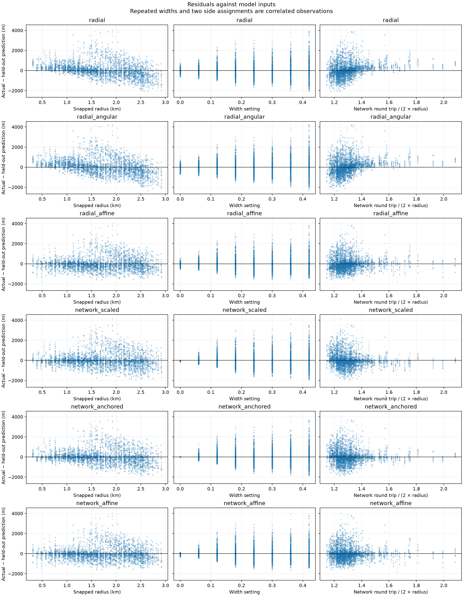
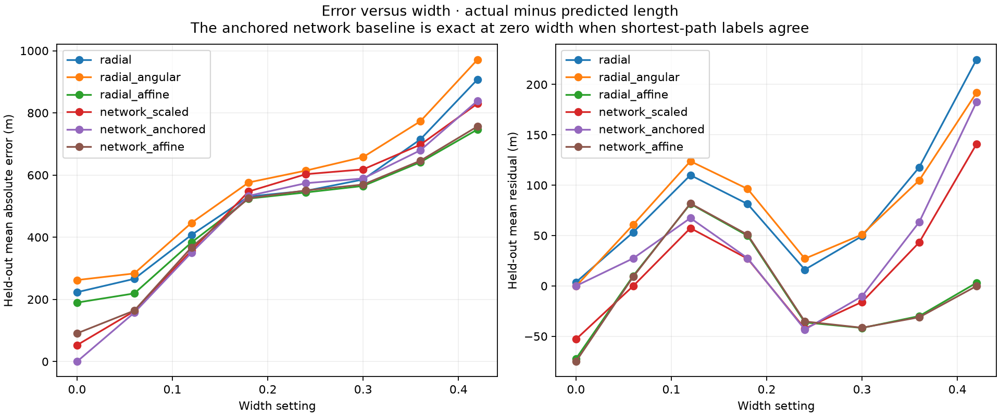

# Pasila loop-length grid and baselines — 2026-10-29

This repeats the [Leppävaara grid](54-loop-length-grid.md) and
[six-model comparison](55-loop-length-baselines.md) from a second start. The
grid settings and buffered spatial validation are unchanged; each model is
refitted locally. This tests the model families at another start, not transfer
of Leppävaara coefficients or prediction at unseen widths/preferences.

## Configuration and reproduction

The requested start is `(24.934125, 60.198361)` (longitude, latitude), beside
Pasila station's Pasilansilta entrance. Its location was selected using the
[documented entrance viewpoint](https://commons.wikimedia.org/wiki/File:Pasila_railway_station_%28Pasila,_Helsinki,_Finland%29_Aug_21,_2024.jpg).
It snaps 8.13 m to segment `w133875783p1` at
`(24.9339784773051, 60.19836231712753)`.

The grid faces EPSG:3067 north, with forward distances 300–2,500 m and lateral
offsets −1,500–1,500 m (positive left/west), 20 × 20 positions, and widths
0, 0.06, 0.12, 0.18, 0.24, 0.30, 0.36, 0.42. Width is the application's
dimensionless avoidance parameter, not a measured ellipse aspect ratio.
Preferences: hills off, all surfaces, stairs avoided, 50 m snap radius,
3 s planner deadline, other settings at application defaults.

```sh
uv run --extra web --extra experiments python -m runmap.experiments.loop_length_grid \
  data/paths/prepared/helsinki-capital-area/network.sqlite \
  artifacts/loop-length-grid/pasila-north-2026-10-29 \
  --home 24.934125 60.198361 --timeout 3

uv run --extra web --extra experiments python -m runmap.experiments.fit_loop_length \
  artifacts/loop-length-grid/pasila-north-2026-10-29 \
  data/paths/prepared/helsinki-capital-area/network.sqlite \
  artifacts/loop-length-fit/pasila-north-2026-10-29 \
  --block-size 5 --buffer 1
```

Use fresh output directories. Commands and output contracts are maintained in
the [development guide](../../development.md#loop-length-parameter-grid).
The [grid record](56-pasila-loop-length-grid.json) preserves the complete manifest, dataset
and source identity, summary, snapped home, failing inputs, and raw-file hash.
The [fit record](56-pasila-loop-length-baselines.json) preserves all coefficients, validation
metrics, outliers, feature timings, and provenance. Raw compressed responses,
CSV tables, and SVG figures remain in the local artifact directories above.

## Sampling results

| Measurement | Pasila |
| --- | ---: |
| Evaluations | 3,200 |
| Complete evaluations | 2,783 |
| Complete candidate loops | 5,218 |
| Positions complete at every width | 347 / 400 |
| Status counts | `{"complete": 2783, "deadline": 113, "no_eligible_snap": 272, "planner_error": 32}` |
| Physical length range | 1127.2–12482.9 m |
| Neighbor length difference, median / p95 | 230.9 / 1132.8 m |
| Width increases reducing length by >1 m | 34 / 4870 |
| Coverage-limited evaluations | 0 |
| Evaluation wall time, median / p95 | 171.5 / 1407.4 ms |
| Sampling wall time | 1129.1 s |

Only complete results supply labels. Both side assignments are retained, with
zero width counted once. Missing snaps, deadlines, and validation errors are
excluded rather than assigned artificial distances. Timings include in-process
preparation and routing; they are not isolated latency benchmarks. Neighbor
differences describe sampled changes, not proof of mathematical discontinuities.

## Model comparison

Definitions are identical to the [first fit](55-loop-length-baselines.md#models-and-validation).
All widths/sides at a position stay together in leave-one-spatial-block-out
validation, using 5 × 5 blocks and a one-cell training exclusion buffer.
There are 16 populated folds and 5,218
observations at 348 completed positions. No Ramanujan or
piecewise model is fitted in this repetition.

| Model | Leppävaara MAE | Pasila MAE | Pasila RMSE | Pasila p95 absolute error | Pasila R² |
| --- | ---: | ---: | ---: | ---: | ---: |
| `radial` | 542.0 m | 543.0 m | 753.0 m | 1545.2 m | 0.892 |
| `radial_angular` | 470.3 m | 593.6 m | 799.9 m | 1655.5 m | 0.878 |
| `radial_affine` | 468.9 m | 495.7 m | 687.3 m | 1382.5 m | 0.910 |
| `network_scaled` | 632.2 m | 512.1 m | 728.2 m | 1553.8 m | 0.899 |
| `network_anchored` | 557.2 m | 496.2 m | 718.7 m | 1532.1 m | 0.901 |
| `network_affine` | 410.5 m | 483.2 m | 683.9 m | 1390.0 m | 0.911 |

The best locally validated model is `network_affine`: MAE
**483.2 m**, with p95 absolute error
**1390.0 m**. Its held-out adjacent residual correlation
is **0.678**. The maximum difference between independently computed
network baseline and measured zero-width length is
4.55e-12 m.

These are exploratory within-start spatial holdouts. Comparing their scores
describes different local tasks and missing-label patterns; it does not isolate
the causal effect of railways or roads. Other preference presets, transfer
between starts, route-quality acceptance, and calibrated residual models remain
unvalidated.

### Interpretation

The affine network model again has the lowest MAE, but its improvement over
affine radial is only 2.5% here, versus 12.4% in Leppävaara. Network scaling
performs better than the proportional radial model in Pasila, reversing their
ordering in the first experiment. Angular terms worsen spatial-holdout error.
The relative value of these features therefore depends on the start and sampled
region; a more flexible mean does not consistently improve spatial prediction.

Errors grow strongly with width: the affine network model's held-out MAE rises
from 91 m at zero width to 526 m at width 0.18 and 757 m at width 0.42. Its worst
error is a 4,013 m underprediction at forward 1,921 m, lateral −79 m, width 0.36
(outbound left). The residual maps show concentrated spatial bands of
underprediction, especially at high width, rather than uniformly scattered
errors. This supports investigating local or piecewise structure without yet
establishing which partition or physical barrier explains it.

Width sweeps show plateaus, large jumps, and occasional decreases: 34 decreases
over 1 m among 4,870 comparisons, versus 15 / 5,110 in Leppävaara. Paired side
assignments differ by a median 0.001 m, p95 283 m, and a maximum 3,040 m; rare
side-dependent changes remain important despite typical near-agreement.

All 32 planner errors have the same endpoint-offset validation message recorded
in the first grid. Network-feature computation took 1.77 s for this start;
its search extent was selected from observed feasible leg lengths, as in the
first analysis. This is offline preprocessing, not established application
latency or a fitted length feature.

## Plots

Grid plots preserve both side assignments. Residual maps average their errors
and share an unclipped color scale across models. Grey cells have no complete
label. Residuals mean actual minus predicted physical length.

















## Verification

The nine focused grid/fit tests pass. The archived reports retain the complete
sampling status and source identity; partial/deadline results are excluded from
model labels by the existing analysis pipeline.
