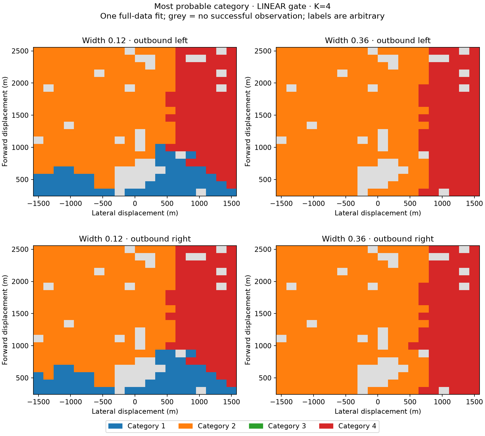
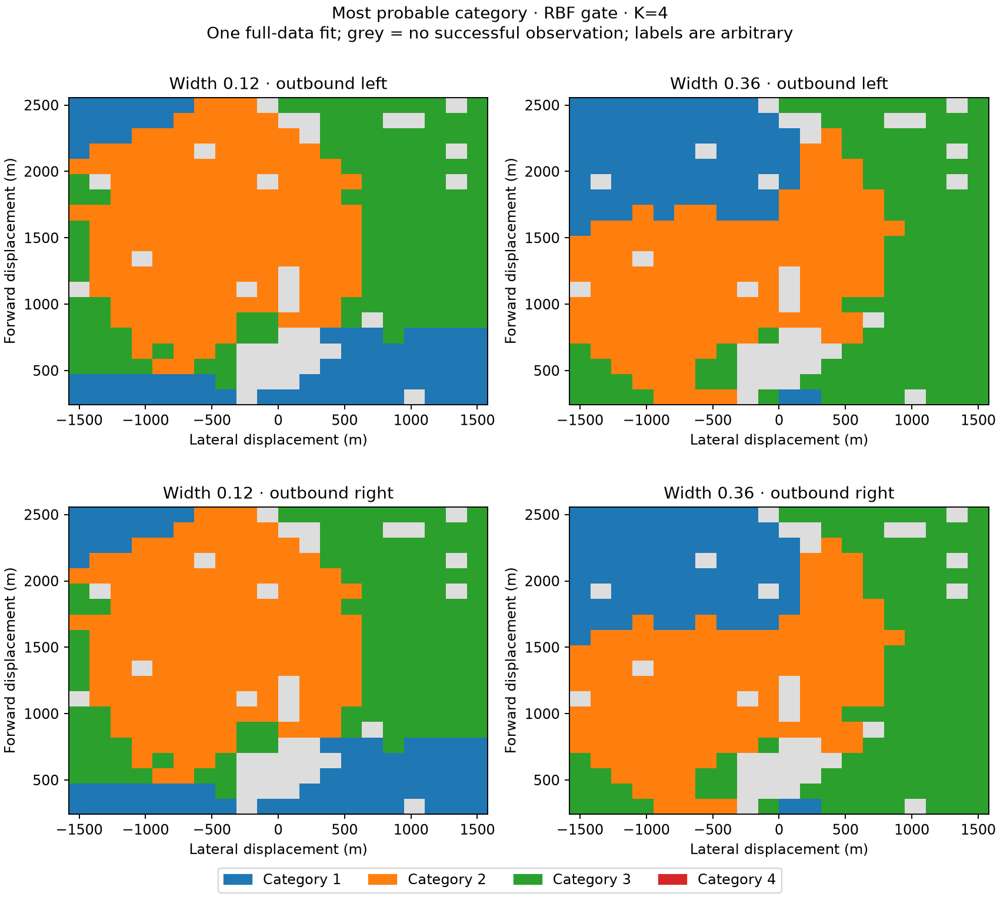
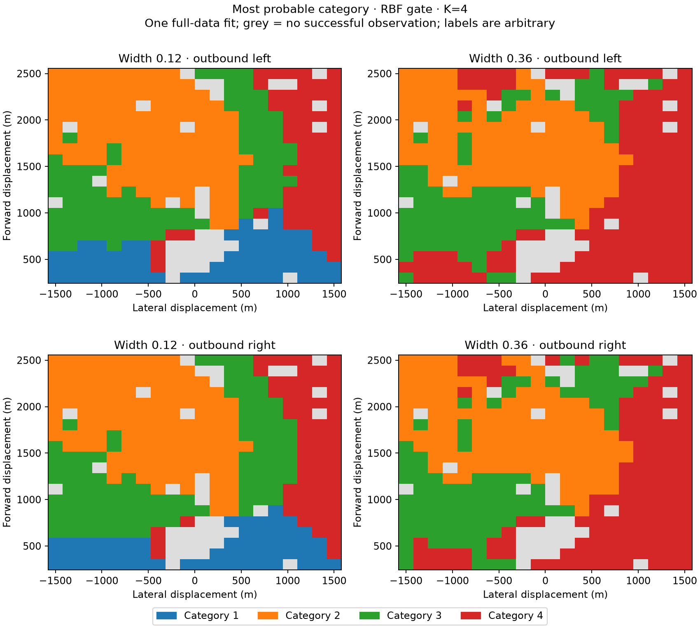
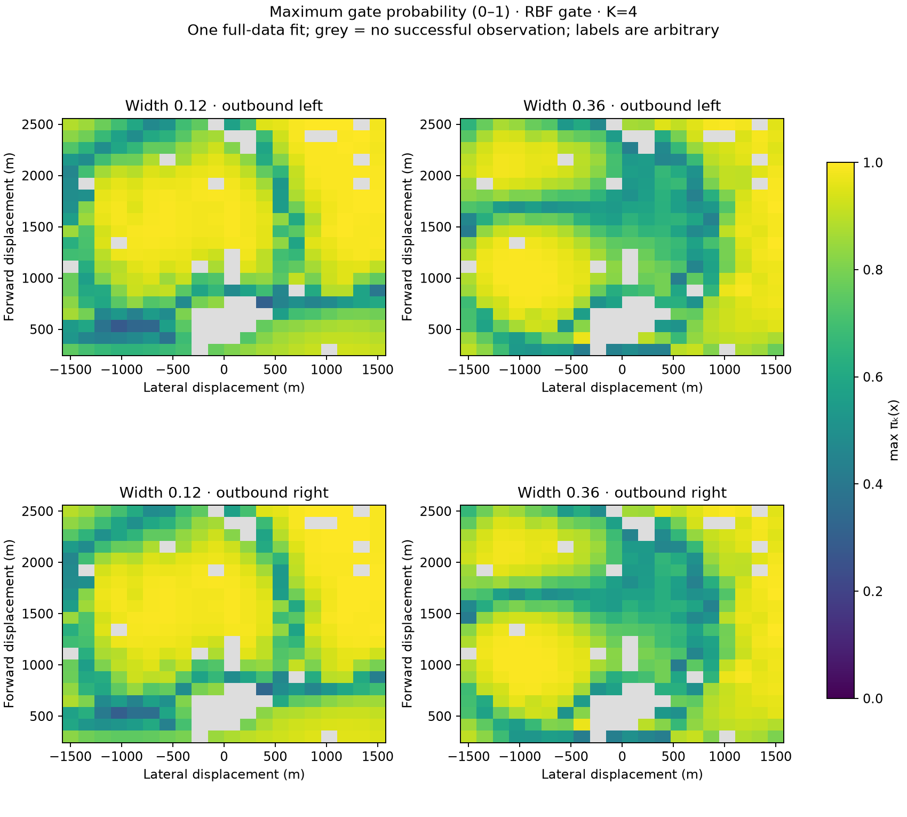

# RBF loop-length gates — 2026-10-30

This experiment compares linear and radial basis function (RBF) gates with the
same four polynomial experts on the 5,475 completed Leppävaara observations.
The [measurement record](58-rbf-loop-length-gate.json) preserves priors, input
identity and hashes, full-data parameters, and fold diagnostics. Current
[commands](../../development.md#loop-length-map-mixtures) and
[mathematics](../../reference/loop-length-mixture.md#rbf-gate) are maintained
separately. The [previous report](57-loop-length-mixture.md) compared expert counts.

## Configuration and held-out results

All fits use K=4, three seeded restarts, at most 300 EM iterations, and the same
proper Gaussian and inverse-gamma priors as the first implementation. Seed is 0
and relative MAP objective tolerance is 1e-6. Spatial validation retains sixteen
blocks and a one-cell buffer; all widths and sides at each position stay together.
The linear comparison reproduces the previous four-expert result.

The RBF gate retains linear inputs and adds sixteen radial features over
training-standardized forward position, lateral position, and width. Centers
are selected from training inputs by farthest-point coverage, separately in each
fold. Length scales 0.8 and 1.2 use those standardized units. The RBF optimizer
uses an exact Hessian, with an L-BFGS-B fallback and explicit stationarity checks
for numerical stalls; the conditional MAP objective remains unchanged.

| Gate | Soft MAE | Hard MAE | Soft RMSE | Soft signed bias | Mean negative log density |
| --- | ---: | ---: | ---: | ---: | ---: |
| Linear | 335.23 m | 341.33 m | 450.21 m | −1.75 m | 7.3824 |
| RBF, h=0.8 | 337.83 m | 360.48 m | 455.37 m | +12.45 m | 7.4568 |
| RBF, h=1.2 | **319.93 m** | 347.27 m | 450.76 m | +57.11 m | **7.3455** |

Bias is actual minus predicted length. Negative log density uses lengths in
metres. Every selected fold fit and every full-data fit converged.

The broader RBF gate improves soft MAE by about 4.6% and improves density
prediction relative to the linear gate. RMSE is essentially unchanged, hard
selection MAE worsens, and the positive signed bias indicates more systematic
underprediction. The narrower gate does not improve average prediction.
Length-scale selection on these holdouts remains exploratory; this is not
evidence of a universal RBF advantage, calibrated uncertainty, or fewer planner
evaluations. Priors and transfer across starts still need validation.

## Most probable categories at two widths

Each figure evaluates the gate without observed length labels, using one
full-data model for every panel. Columns are widths 0.12 and 0.36; rows are the
two outbound side assignments. Grey cells have no successful observation.
Category indices are arbitrary across fits: colors must not be matched between
the linear and RBF models. These are sampled input maps, with no interpolation
through missing positions, and are descriptive rather than held-out predictions.

The linear gate provides the comparison:



The RBF gate with h=1.2 forms curved and disconnected regions that change with
width. Category 4 does not win in these slices, but has effective training
responsibility about 628 out of 5,475 observations; absence from an argmax map
does not imply an unused mixture component.



The h=0.8 fit gives another partition despite its slightly worse held-out errors:



The maximum input-only gate probability shows ambiguous selections near some
boundaries. It is not posterior parameter confidence or an information-gain
estimate for adaptive sampling.



### Why the side panels look similar

The [side sensitivity record](58-gate-side-diagnostics.json) compares predictions
with the side indicator switched while holding every other input fixed. For
the h=1.2 full-data fit, the argmax category changes at 0/365 positions at width
0.12 and 3/365 at width 0.36. Nevertheless, predicted means differ by an average
4.32 m and 3.56 m respectively; the largest component probability changes are
0.108 and 0.040. Across all sampled widths the mean absolute predicted side
effect is 8.23 m and its maximum is 116.23 m, counting each successful position
and width once, including hypothetical side switches at zero width.

The data do not make side redundant: across 2,555 actual left/right pairs the
mean absolute length difference is 48.86 m, p95 is 219.97 m, and the maximum is
2,097.63 m, although the median is effectively zero. The present experts share
their means across sides and the gate has only an additive side logit shift.
It may underrepresent local side-dependent effects; similar argmax maps alone
do not establish that dropping side preserves predictive accuracy. A retrained
held-out ablation is needed before removing the input, and side interactions
remain a possible extension.

## Reproduction and validation

```sh
uv run --extra web --extra experiments python -m runmap.experiments.fit_loop_length_mixture \
  artifacts/loop-length-fit/leppavaara-north-2026-10-28-final \
  artifacts/loop-length-mixture/leppavaara-linear-2026-10-30 \
  --components 4 --restarts 3 --gate linear --plot-widths 0.12 0.36

uv run --extra web --extra experiments python -m runmap.experiments.fit_loop_length_mixture \
  artifacts/loop-length-fit/leppavaara-north-2026-10-28-final \
  artifacts/loop-length-mixture/leppavaara-rbf-h08-2026-10-30 \
  --components 4 --restarts 3 --gate rbf --rbf-count 16 --rbf-length-scale 0.8

uv run --extra web --extra experiments python -m runmap.experiments.fit_loop_length_mixture \
  artifacts/loop-length-fit/leppavaara-north-2026-10-28-final \
  artifacts/loop-length-mixture/leppavaara-rbf-h12-2026-10-30 \
  --components 4 --restarts 3 --gate rbf --rbf-count 16 --rbf-length-scale 1.2
```

Use fresh output paths when repeating. Local experiment directories retain
complete fold fits, CSV predictions, and PNG/SVG figures. No new planner calls
were made. Focused tests cover a curved synthetic regime on unseen inputs,
training-only centers, prediction scaling, exact gate derivatives, and safeguards
against accepting a nonstationary or worse stalled gate update. Category and
probability figures were visually inspected.
The final Python regression suite passed all 413 tests.
