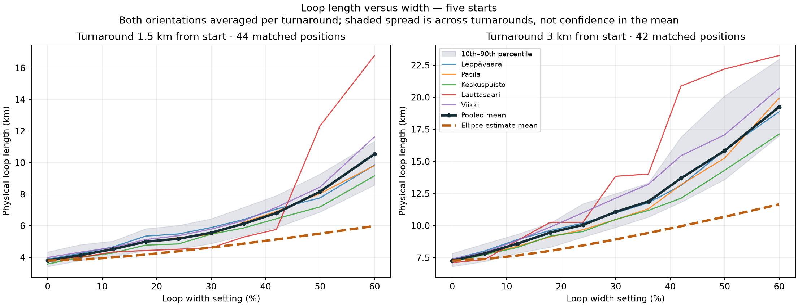
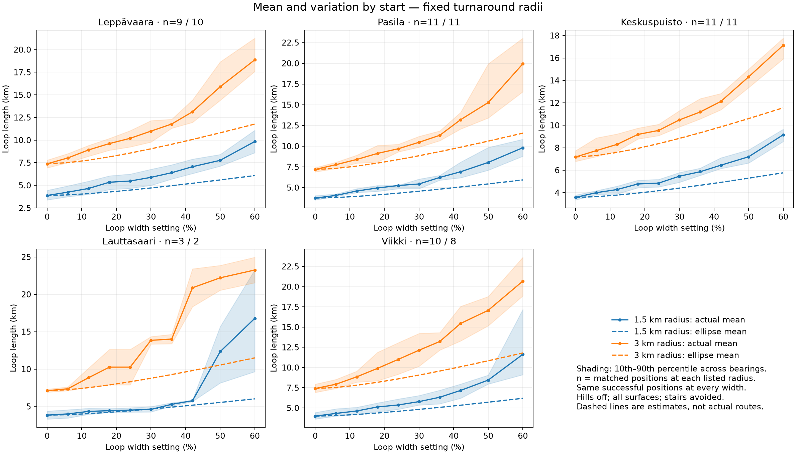
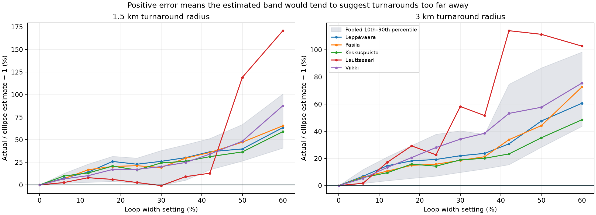

# Multi-start loop width response — 2026-11-02

The runtime ellipse allowance substantially underestimates measured loop length
at wider settings in this experiment. At width 50%, actual loops exceed their
estimates by a mean 48.2% for 1.5 km turnarounds and 48.4% for 3 km turnarounds.
At 60% these rise to 75.7% and 65.4%. Variation also grows with width, with
large local changes in the sparse Lauttasaari cohort. These observations audit
the heuristic; no replacement model was fitted or installed.

## Design and evidence

Five requested starts, all successfully snapped within 50 m:

| Start | Requested longitude, latitude | Matched bearings at 1.5 km / 3 km |
| --- | --- | ---: |
| Leppävaara | 24.795, 60.216 | 9 / 10 |
| Pasila | 24.934125, 60.198361 | 11 / 11 |
| Keskuspuisto | 24.908, 60.233 | 11 / 11 |
| Lauttasaari | 24.875, 60.160 | 3 / 2 |
| Viikki | 25.016, 60.227 | 10 / 8 |

Each start uses two requested EPSG:3067 radii, twelve bearings at 30° intervals,
and ten widths: 0, .06, .12, .18, .24, .30, .36, .42, .50, .60. Preferences are
hills Off, all surfaces, stairs avoided, 50 m snapping, default shape settings,
and a 3 s planner deadline. Snapped separation can differ slightly from requested
radius; the estimator comparison uses exact snapped separation.

Of 1,200 evaluations, 885 completed, 280 had no eligible snap, 20 raised planner
validation errors, and 15 reached a search-area limit. No evaluations reported
a deadline result. Sampling took approximately 155 s, excluding plotting.
The errors repeat the previously observed endpoint-offset validation issue;
failed inputs and full responses remain in the raw sample file.

Retaining only positions complete at all ten widths gives **86 positions**
(44 at 1.5 km, 42 at 3 km), 860 evaluations and 1,634 candidate loops. Positions
with any failure are excluded at every width: the plotted trend does not change
its cohort as width increases. Both orientations are averaged per position
before computing mean, population SD and empirical quantiles across bearings.
Zero width contributes once. Pooled means weight positions equally; starts with
more surviving bearings contribute more. The shaded ranges are variation across
turnarounds, not confidence intervals on an inferred population mean.

The [machine-readable report](59-multi-start-loop-width.json) preserves the full
manifest, dataset/model/source identities, raw-file SHA-256, all summary
statistics and failure counts. Dataset identity is recorded there rather than
assuming that a path identifies immutable data. Full raw responses and CSV/SVG
artifacts are in the ignored directory
`artifacts/loop-width-sweep/multi-start-2026-11-02/`.

## Mean and variation

Values below are mean physical loop length ± population SD in kilometres,
after averaging route orientations per turnaround.

| Width | 1.5 km turnaround radius | 3 km turnaround radius |
| --- | ---: | ---: |
| 0% | 3.79 ± 0.35 | 7.27 ± 0.42 |
| 18% | 4.99 ± 0.53 | 9.46 ± 1.12 |
| 30% | 5.55 ± 0.63 | 11.07 ± 1.37 |
| 42% | 6.80 ± 0.76 | 13.69 ± 2.53 |
| 50% | 8.16 ± 1.77 | 15.84 ± 2.52 |
| 60% | 10.54 ± 3.14 | 19.25 ± 2.46 |

The physical-length response is much stronger than the ellipse allowance.
At 50% width, the ellipse predicts mean lengths of only 5.50 and 10.69 km for
the two radius groups, compared with actual means of 8.16 and 15.84 km.
At 60%, estimates are 5.98 and 11.65 km versus actual 10.54 and 19.25 km.
Increasing width also expands directional variation; mean response alone cannot
predict an individual turnaround reliably.

The same overall underestimation appears across the five starts, but magnitude
and shape differ. Lauttasaari's steep changes rest on just three and two usable
bearings and should not be treated as a stable local law. The plot does not
identify which barriers or route choices cause particular jumps. That requires
inspecting the saved route geometries and network alternatives.

## Ellipse bias

For each position, the comparator is

$$
\widehat L(w)=L(0)+r\,[p(w)-2],
$$

where $L(0)$ is the physical zero-width route length with hills off, $r$ is exact
snapped projected separation, and $p$ is the runtime ellipse perimeter ratio
(with its explicit zero-width limit). This equals the distance-only baseline
contract at width zero; it is a comparator, not a fitted or independently
validated predictive model. Error is $100(L(w)/\widehat L(w)-1)$, with orientations
averaged first. Averaging these ratios differs slightly from taking the ratio
of pooled means.

At the default width of 18%, mean relative errors are already +19.9% and +17.7%.
At 50%, every start/radius group overpredicts the useful turnaround distance in
the sense that actual lengths exceed the estimator on average. This explains
the reported app behavior: a target-length contour based on this estimate can
place the turnaround too far from home. Fixed-radius comparisons support that
direction of error; they do not directly measure target-length contour success.

## Limits and next experiment

This is a deterministic directional sample at five starts and two radii, not a
random or comprehensive regional survey. Missing snaps, endpoint errors and area
limits select the retained cohort; excluding difficult directions can hide long
routes and reduce observed variation. Hill preferences, other radii, route
quality and runner acceptance remain untested. In-process sampling time is not
an interactive latency benchmark.

The next calibration should fit the width response using these paired network
features, retain whole starts as holdouts, and compare against the ellipse under
actual target-length selection. More successful bearings are needed before
interpreting Lauttasaari-specific trends. Inspect large route changes and repeated
distance rather than optimizing length error alone. Do not substitute a universal
multiplier based on the pooled mean without checking these location differences.

Reproduction and CLI contracts belong in the
[development guide](../../development.md#multi-start-loop-width-sweep). Four focused
tests validate metric radial sampling, width/configuration constraints, paired
cohort exclusion, orientation averaging, and population-variation statistics.
All three final figures were visually inspected.
