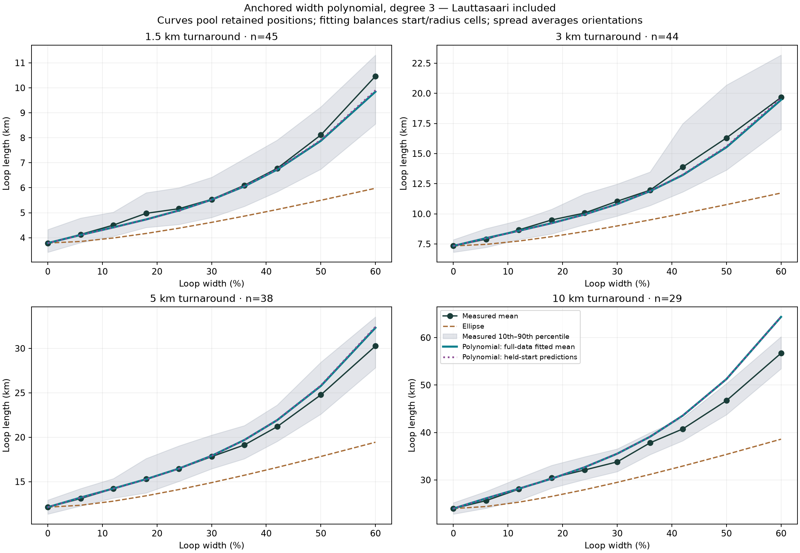
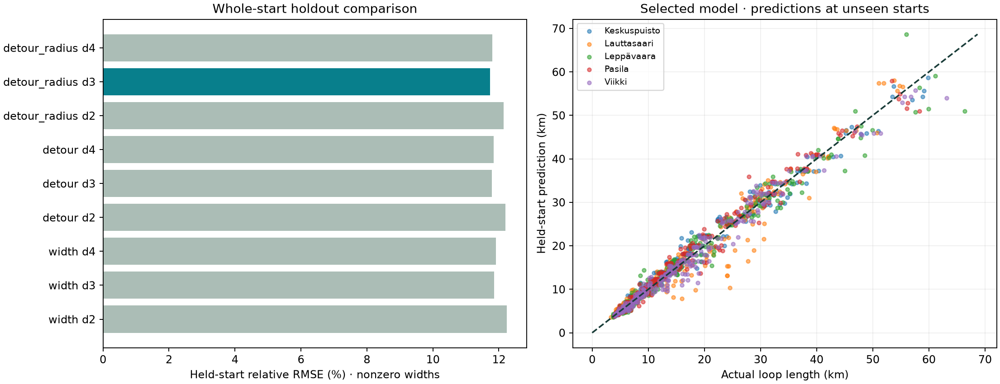

# Extended turnaround distances and empirical polynomials — 2026-11-02

A cubic width correction substantially improves the ellipse estimate on the
expanded multi-start experiment. The simple three-coefficient fit has **8.71%**
mean absolute percentage error in whole-start holdout, versus **18.51%** for the
ellipse. A nine-coefficient cubic with detour/radius interactions scores slightly
better at **8.49%**, but has one decreasing-width diagnostic and only a marginal
validation advantage. Lauttasaari is retained throughout, without robust-loss
weighting, clipping, or outlier removal.

These are experimental fits, not a runtime model change or an independent final
test of target-distance selection. Reproduction commands and maintained contracts
belong in the [development guide](../../development.md#anchored-empirical-width-polynomials).

## Sampling and search coverage

The five starts, twelve bearings and ten widths are unchanged from the
[first multi-start sweep](59-multi-start-loop-width.md). Requested EPSG:3067
turnaround radii now include **1.5, 3, 5 and 10 km**. Hills are Off, all surfaces
are allowed, stairs avoided, and endpoint snapping is limited to 50 m.

A first 2,400-evaluation run with production search caps and a 10 s deadline
completed 1,500 evaluations, with 750 missing snaps, 20 endpoint-offset validation
errors and 130 `maximum_area` results. No 10 km position completed at every width.
Thus fitting only its matched cohorts would silently omit the requested 10 km
extension. Its raw evidence is retained separately in
`artifacts/loop-width-sweep/multi-start-extended-2026-11-02/`.

The final experiment reruns every radius under the same **offline-only** settings:
15 s deadline, 10,000 km² maximum search area, 1,200,000 segments and two concurrent
planner slots. Other search settings retain their defaults. These settings do not
change application limits. A previously blocked 10 km example completed under the
larger window and produced approximately 60 km loops.

The final run completed 1,577 of 2,400 evaluations; the other outcomes were 750
missing snaps, 30 unreachable requests in the prepared graph, 20 endpoint-offset
validation errors, and 23 remaining area-limit results. There were no deadline
results or source-coverage warnings on completed evaluations. Its wall time was
approximately 490 s with two workers; this is not an interactive latency benchmark.

Matched-cohort analysis retains **156 positions**, 1,560 evaluations and 2,964
candidate loops. Every retained position completed at all ten widths with both
nonzero-width side assignments and identical endpoint snaps. Zero width supplies
one candidate. Both orientations are averaged before fitting or computing spread.

| Start | 1.5 km | 3 km | 5 km | 10 km |
| --- | ---: | ---: | ---: | ---: |
| Leppävaara | 9 | 10 | 9 | 6 |
| Pasila | 11 | 11 | 5 | 6 |
| Keskuspuisto | 11 | 11 | 10 | 6 |
| Lauttasaari | 4 | 4 | 5 | 6 |
| Viikki | 10 | 8 | 9 | 5 |
| Total | 45 | 44 | 38 | 29 |

[Observed per-start means and variation](60-width-by-start.png) show all four radii,
including the constrained Lauttasaari cohorts.

The [sampling record](60-extended-width-sweep.json) preserves native-binary,
dataset, cost-model and source identities, complete configuration, raw-file hash,
outcomes and per-start/radius/width statistics. Final raw responses, matched CSV
and SVG/PNG plots are in
`artifacts/loop-width-sweep/multi-start-wide-window-2026-11-02/`. The fit uses only
this final run; it does not mix labels from the earlier capped run or short-radius
pilot. Distinct runs have their own provenance.

## Polynomial families and validation

Let $r$ be snapped projected separation in metres, $b$ the zero-width physical
loop length with hills Off, and $q=w/0.6$, where slider width $w$ lies in $[0,0.6]$.
The baseline $b$ is the shortest directed round trip under the selected access
policy. The tested families are

$$
\widehat L=b+rP(q),
$$

$$
\widehat L=b+r[P(q)+(b/r-2)Q(q)],
$$

and

$$
\widehat L=b+r[P(q)+(b/r-2)Q(q)+(r/10000)S(q)].
$$

Every polynomial has no constant term, so zero width is anchored exactly to $b$.
Degrees 2, 3 and 4 are compared. Weighted least squares minimizes squared error
in $(L-b)/r$. Each of the twenty represented start/radius cells has equal total
weight. Thus Lauttasaari has the same total weight as any other start, despite
fewer surviving directions. No observation is removed for having a large length
or residual.

Validation leaves each entire start out, including all radii, bearings and widths;
a separate analysis leaves each entire requested radius out. Reported errors
exclude zero width so the exact anchor cannot artificially lower the scores.
The main selection score is cell-balanced relative RMSE in whole-start holdout.
The model comparison itself is exploratory; there is no untouched final test.
Nearby starts can share route geography, so this is not a spatially separated
regional holdout.

| Family | Degree | Held-start MAPE | Held-start relative RMSE | Held-radius MAPE |
| --- | ---: | ---: | ---: | ---: |
| Width | 2 | 9.12% | 12.24% | 9.30% |
| Width | 3 | 8.71% | 11.85% | 8.92% |
| Width | 4 | 8.77% | 11.91% | 8.97% |
| Width + detour | 2 | 9.03% | 12.20% | 9.26% |
| Width + detour | 3 | 8.64% | 11.79% | 8.80% |
| Width + detour | 4 | 8.70% | 11.85% | 8.85% |
| Width + detour + radius | 2 | 8.89% | 12.15% | 9.11% |
| Width + detour + radius | 3 | **8.49%** | **11.73%** | **8.70%** |
| Width + detour + radius | 4 | 8.56% | 11.80% | 8.73% |

On the same retained cases and weighting, the ellipse has 18.51% MAPE and 22.35%
relative RMSE. It requires no fitting, so its comparator scores are direct errors
rather than trained holdout predictions. Full-data coefficients, train metrics,
fold predictions, per-group errors and physical diagnostics are in the
[fit record](60-width-polynomial-fit.json). Prediction CSV and SVGs are in
`artifacts/loop-width-fit/multi-start-wide-window-reviewed-2026-11-02/`.

## Simple cubic candidate

The compact fit is

$$
\boxed{\widehat L=b+r(2.293494q-1.665534q^2+3.411922q^3)}.
$$

At 30% width, $q=0.5$. Lengths $b,r,\widehat L$ all use metres. This is a
baseline-plus-shape model, not a multiplier on the whole network distance.
The correction is nonnegative and increasing throughout the sampled width range.
Dense checks found no predictions below baseline or decreasing-width positions.

Whole-start holdout MAE is 1.69 km over the full length range. MAPE is 8.71%;
39.1% of weighted cases fall within 5%, and 67.7% within 10%. Holding out each
radius instead gives 8.92% MAPE. Lauttasaari remains the most difficult start,
with 14.4% held-start MAPE versus approximately 7.1–7.5% at the other starts.

The shaded regions are empirical 10th–90th percentiles across retained turnaround
locations, after averaging orientations. They are not fitted uncertainty or
confidence intervals. Curves pool positions equally; fitting weights start/radius
cells equally. That distinction explains why a fitted pooled curve need not
pass exactly through the position-weighted observed mean.

The simple cubic is a practical candidate for further integration work: it uses
three coefficients, preserves the network anchor, and gives most of the measured
improvement. That recommendation is a simplicity tradeoff; the nine-coefficient
model wins the stated numerical comparison.

## Best-scoring richer cubic

For the last model family above, the full-data polynomials are:

| Polynomial | Coefficient of $q$ | Coefficient of $q^2$ | Coefficient of $q^3$ |
| --- | ---: | ---: | ---: |
| $P$ | 2.048324 | 3.598440 | −1.660942 |
| $Q$ | 0.837346 | −11.278707 | 12.170060 |
| $S$ | −0.285511 | −0.177959 | −1.053296 |

Whole-start holdout MAE is 1.47 km and MAPE 8.49%. At the 5 km and 10 km radii,
held-start MAPE is 7.57% and 4.84%, respectively. Lauttasaari's corresponding
start-level MAPE is 13.28%. Dense-width checks found no predictions below baseline,
but one position with a decreasing-width interval; there are no monotonicity
constraints or post-fit clipping.

The improvement over the simple cubic is just 0.21 percentage points of MAPE.
Five starts do not establish that this small advantage will persist elsewhere.
The [best-model curve plot](60-polynomial-width-curves.png) gives the fitted and
held-start mean curves at each radius.

## Remaining limits

All fits are conditional on successful all-width positions. Missing snaps,
remaining area limits, endpoint errors and disconnected targets select that
cohort; difficult long directions are not fully represented. Larger offline
windows also mean these labels do not prove the app can currently generate every
predicted run under its smaller limits. No hill-preference, orientation-specific,
route-quality or target-distance contour acceptance was performed.

The extension supports polynomial calibration across 1.5–10 km requested radii
and widths 0–60%; it does not validate extrapolation beyond that domain, or at
new regions. Before runtime replacement, test target-length contour selection,
use a new start or final evaluation set, review repeated-distance/route quality,
and decide how the remaining broad variation should affect the displayed band.

Thirteen focused tests cover sweep geometry/configuration, matched cohorts,
orientation averaging, polynomial recovery, exact zero anchoring, cell weighting,
whole-start leakage protection, distinct plot artifact names, and the existing grid's default behavior. Final
fit and validation plots were visually inspected. The runtime estimator and
application search caps are unchanged.
