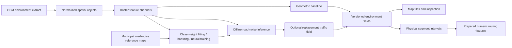

# Environment preferences: routing integration and road-noise learning

Status: pilot acquisition, source inspection, and the four-field raster baseline
are available. Regional tile preparation/delivery and main-map controls are
implemented and the capital-area source and raster are prepared from a dated
Finland PBF. The local runner accepted the map-layer visuals, ordinary UI use,
and rendering latency on 2026-11-05. Segment projection and pure cost functions
are implemented; routing consumption and preference controls remain planned.
Updated 2026-11-06.

The [source inspection map](guide.md#environment-source-inspection) and
[four raster layers](guide.md#experimental-environment-rasters) are implemented
for the Leppävaara pilot. The current greenery, water, traffic-exposure, and
wetland layers are sufficient to start application integration, with focused
fixes as needed. A manual OSM-validation or location-labeling campaign is not
part of the plan and is not a prerequisite for routing integration.

This document owns the proposed design for two independent development tracks;
the [roadmap](roadmap.md#planned-environment-preferences-experiment) owns their
outstanding work and acceptance criteria. Existing capabilities remain in the
[guide](guide.md).

The dated [acquisition](archive/history/2026-11-02-environment-acquisition.md),
[inspection](archive/history/2026-11-02-environment-inspection.md),
[raster](archive/history/2026-11-02-environment-rasters.md), and
[road-noise proxy](archive/history/2026-11-02-road-noise-proxy.md) reports preserve
pilot evidence and limitations; they do not establish complete mapping or
calibrated real-world noise.

## Two development directions

1. **Routing application integration:** the main routing map displays the
   rasters through tiled delivery, and an offline join projects their values
   onto physical route segments. Next connect that join to routing and design
   the cost structure and preference-weighting UI.
2. **Road-noise learning:** predict municipal road-noise maps from OSM inputs
   only. First fit the existing road-exposure model's road-class weights to the
   reference data, then compare gradient boosting and neural networks.

Routing integration can proceed with the current baseline independently of the
learning experiment. Main-map exploration, segment projection, and routing costs
are the next priority; road-noise learning follows later. Existing-feature
validation is deferred in the roadmap and does not block this integration.
Greenery, water proximity, and wetlands remain geometric
OSM-derived layers; learning missing woodland or collecting manual labels for
all four fields is outside the current scope. A successful noise model can later
replace the traffic field through the same versioned field/segment interfaces.

## Spatial meaning and overlapping outputs

Keep mapped objects, estimated surroundings, and personal preferences separate:

| Quantity | Meaning | Initial representation |
| --- | --- | --- |
| Woodland coverage | Mapped woodland footprint, including woodland inside parks/reserves and polygon holes | Source polygons and per-cell area fraction with evidence provenance |
| Greenery, G | Woodland surroundings plus weaker park/reserve contributions within their polygons | Continuous score in [0, 1] |
| Park coverage, P | Mapped `leisure=park` footprint, excluding nature-reserve designation alone | Internal per-cell fraction used by Greenery |
| Water proximity, W | Proximity to any mapped water-polygon boundary or coastline | Continuous score in [0, 1], with separate interior/distance evidence |
| Traffic exposure, T | Proxy for traffic-related noise and running discomfort from nearby roads | Continuous score in [0, 1] |
| Wetland presence, H | Mapped wetland footprint, independent of woodland or open water | Per-cell area fraction in [0, 1] with separate validity |
| User preferences | Tradeoffs between route length and environment attributes | Separate nonnegative routing weights |

G, W, T, and H do not sum to one. A wooded lakeside wetland beside a major road
can score highly on all four. Do not subtract traffic or wetlands from greenery
or assign one winning class per cell. Retain continuous fields; thresholded
contours are display products, not the underlying data model.
Park coverage is an internal Greenery input and can overlap woodland, water
context, and wetlands. It is not exposed as a separate preference class.

Land cover and surroundings have different targets. A path just outside a
woodland polygon may have wooded surroundings. Water proximity does not imply
a view of water or access to its shore. Road-derived exposure does not measure
current traffic, noise, air quality, or safety. The initial feature offers
traffic avoidance as a soft preference; a guarantee of no nearby traffic is
outside this experiment.

### Source interpretation after pilot review

The user's source-map review identified these requirements before field generation:

- **Woodland inside parks and nature reserves:** retain park/reserve boundaries
  as weaker greenery evidence within the polygon, not automatic woodland
  labels. Include explicitly mapped woodland within them at higher weight. Where a wooded park
  lacks woodland geometry, retain that limitation; adding further cover evidence
  is a possible later fix rather than a required manual review task. Do not
  fill an entire park/reserve as forest or treat its unclassified interior as
  confirmed nonforest. Nearby context may help a model, but a designation alone
  cannot establish tree cover.
  The park diagnostic uses `leisure=park` only; reserves have their own
  source toggle and remain separate evidence. A reserve designation alone does
  raise greenery at the configured weaker weight, while keeping the park
  raster and woodland diagnostic separate. V3 uses a maximum of the weighted
  components, so overlapping designations do not add together.
- **Wetlands:** retain their own geometry, support mask, raster field, and
  optional avoidance weight. A wooded wetland may have both high G and high H;
  some users may prefer forest while avoiding wetlands. H initially describes
  mapped wetland presence, not wet footing, flood risk, or path accessibility.
  Route exposure describes mapped wetland context, including paths and boardwalks,
  rather than their surface condition.
- **Water:** use all mapped water-polygon boundaries for inland shoreline
  distance and coastline geometry for coastal distance. Keep water interiors
  identifiable where complete area geometry exists. Line streams/ditches remain
  inspectable context and are excluded from default W, while polygonal water
  bodies contribute regardless of lake classification. Reservoirs, basins, ponds,
  and unclassified water polygons are accepted inputs, not review candidates. Do not infer
  ocean areas by closing arbitrary clipped coastline lines.
- **Roads:** target traffic-related noise and running discomfort, with less-busy
  streets contributing less than major roads at comparable distance. Class is
  an initial prior; the learning track first calibrates class weights against
  municipal road-noise maps. Speed, lanes, and other OSM context are candidate
  later features. Keep missing attributes explicit. The initial field
  is a relative exposure proxy, not measured sound levels or live traffic.

Keep raw OSM tags unchanged. Version these interpretation rules separately from
acquisition, and show which source and rule contributed to each derived field.

## Proposed preparation and delivery boundaries

Environment objects and fields are independent of routing topology. Prepare
them offline; panning and route requests never fetch OSM or run a neural network.
Use bounded spatial reads for tiles and inspection. A missing environment
artifact must leave existing terrain and routing services usable.

Proposed ownership follows the existing [architecture](architecture.md):
`sources/` handles acquisition, the existing `environment/` package handles object
normalization and field preparation, `experiments/` owns training/evaluation,
`paths/` joins fields to physical segments, and `api/` plus `web/src/` deliver
the visualization. Shared routing and native code consume prepared features.
Use data-only containers and module-level functions; a PyTorch model may use
`nn.Module` for its parameter lifecycle. Keep PyTorch in an optional experiment
dependency group rather than an interactive-server requirement.

## Source acquisition and geometry

The initial pilot uses OSMnx's feature API and raw response cache. The
capital-area bundle now uses a dated Geofabrik Finland PBF and Pyosmium area
assembly before spatial selection, so large enclosing polygons can be included
without vertices in the requested rectangle. Source tags and complete selected
geometry are retained. Unassembled relations and real-world mapping completeness
remain explicit limitations. See the [shared snapshot contract](reference/prepared-data.md#shared-osm-snapshot-and-regional-source-bundles).

Reuse OSM acquisition and provenance conventions, with an independent environment
query. The existing runnable-highway extract cannot establish environment
coverage: it excludes forest geometry and many major roads.

- Include `natural=wood` and `landuse=forest`, water areas with their water-body
  types, waterways, wetlands with available subtype tags, and relevant shorelines.
  Preserve parks/reserves and other green areas as distinct candidate evidence;
  retain missing-cover limitations rather than using a designation as cover.
  Preserve water-body types for inspection while accepting all polygonal water. Preserve excluded line streams
  and ditches for inspection without allowing them to raise default W.
- Acquire road context independently of pedestrian eligibility, including major
  roads. Preserve road class, speed/lanes where available, and bridge, tunnel,
  layer, access, and service attributes. Missing attributes get explicit masks.
- Retain buildings as a possible contextual feature. Trees and tree rows are
  optional subsequent inputs; omit them explicitly from the initial manifest.
- Assemble complete multipolygon relations and member ways, respecting inner
  rings. Retrieve complete geometries intersecting the analysis region and halo,
  rather than selecting objects only by contained vertices. Record incomplete
  relations and geometry repairs; do not silently use broken areas as labels.
- Preserve source type/ID, tags, geometry, source time, query, bounds, checksums,
  attribution, and licensing. Deduplicate shared objects and avoid double-counting
  overlapping woodland polygons when calculating union coverage.

The initial acquisition halo is 300 m. Acquire at least that halo around the
display core; enlarge it if feature computation or the model receptive field
requires more context. Track valid support explicitly at boundaries. Every
derived tile must use the same grid origin and full required context before
cropping its core.
Road-noise v2 has no finite 300 m propagation cutoff. It uses retained sources
and separately flags where an exterior source could dominate under configured
strength limits. Expand acoustic context before treating such cells as supported;
the retained-halo flag alone does not establish noise coverage.

A successfully downloaded extract establishes acquisition coverage, not complete
real-world mapping. Store these separately: acquisition/geometry validity,
attribute missingness, municipal target validity, and estimated model uncertainty.
Absence of a forest or road tag is not reliable evidence of absence on the ground.

## Grid, features, and geometric baseline

The delivered baseline uses a 10 m EPSG:3067 grid with 2 m coverage samples;
see the [artifact contract](reference/prepared-data.md#environment-raster-bundles)
for delivered channels and approximations. Keep this grid for initial integration;
revisit resolution if segment projection exposes material sampling errors.
The grid must not change pedestrian connectivity or access permissions.

The first baseline is deliberately reproducible. The rules below distinguish
delivered mapped context from later evidence and calibration improvements:

- F remains the diagnostic mean eligible woodland union coverage in a 100 m disk. Version 1 uses
  explicit woodland polygons, including those mapped within parks/reserves;
  further woodland evidence is optional future work.
  Retain the footprint and provenance
  separately from F. Unresolved tree cover needs an evidence-gap indicator;
  a numeric mapped-only baseline must not imply confirmed forest absence.
- G is `max(F, 0.5 P, 0.5 R)` by default in v3. P/R are park/reserve cell
  coverage with no spatial blur. Keep designation weights configurable below
  woodland's fixed weight 1; forests can contribute more strongly than a
  designation alone. Park and reserve coverage remain diagnostic inputs only.
- W is `max(0, 1 - d / 100 m)`, with d the minimum distance to any mapped
  water-polygon boundary or coastline. Water interiors and distances remain
  separately inspectable. V1/v2 selected explicitly tagged lakes only; v3 accepts
  all mapped water areas. Line streams/ditches remain excluded; missing mapping
  must not silently become evidence of absence.
- H is the union fraction of mapped wetland within the grid cell, with separate
  evidence validity. It can overlap greenery and is not subtracted from G.
- T now uses the [v2 reference-car noise proxy](reference/prepared-data.md#road-noise-proxy-version-2):
  reference intensity at 10 m, effective motorway/trunk intensity attenuation
  `1/r^1.5` or sparse-street `1/r²`, logarithmic dB, and a configurable discomfort scale.
  The class factors are uncalibrated relative-intensity priors. The original
  linear 300 m baseline is retained only for comparison/reproduction. Exclude
  mapped motor-vehicle prohibitions; absent access tags remain an assumption
  recorded in configuration. Preserve this uncalibrated configuration as the
  experiment control; first fit road-class intensity factors against municipal
  road-noise targets. Keep discomfort scaling separate from acoustic calibration.

These are initial proxy definitions, not calibrated probabilities or established
perceptual distances. Save all radii, tag rules, and amplitudes in configuration.
The dominant-source road baseline avoids treating duplicated road geometry as increased
exposure; a road-density model is a later comparison. Preserve bridge/tunnel
evidence for review without assuming that grade separation removes exposure.
The baseline describes mapped context and must display that limitation even
where acquisition coverage is valid.

## Track 1: routing application layers and segment projection

### Tiled map delivery

The main routing map now has a bounded G/W/T/H tile path and independent controls.
See [usage](guide.md#environment-layers-in-the-routing-map),
[regional preparation](development.md#capital-area-environment-layers), and the
[tile API](reference/api.md#environment-map-tiles). It uses on-demand Web Mercator
XYZ PNGs from an offline analytical TIFF, with nearest-neighbor resampling,
versioned cache keys, and bounded source reads. Analytical values remain separate
from colored display tiles. Regional source acquisition is complete through a
[shared Finland snapshot](development.md#shared-finland-osm-snapshot-pipeline).
The local runner accepted visuals, ordinary UI use, and rendering latency on
2026-11-05. Broader keyboard and screen-reader review remains deferred.

Expose independent toggles, opacity, legends, and coverage/no-data indication in
the routing map. Preserve overlapping layers and combinations with terrain,
paths, and route overlays. Check tile seams, zoom changes, rapid panning,
cancellation, stale responses, keyboard/mobile use, and cold/warm delivery costs.
This increment changes visualization before environment weights affect routes.

### Project fields onto route segments

A separate SQLite join now stores analytical-grid intervals for all four fields
on every physical network segment, with graph chainage, projected length,
coverage/support, and raster/network/model identities. It does not sample
colored tiles. The bounded reader and partial-span integration are available;
the planner does not consume the join yet. Compare representative full and
partial segment summaries with direct raster sampling before enabling costs.
Repeated traversals must count each passage when route summaries are added.
The following cost/UI work consumes this prepared join without raster
processing during each route request.

### Cost structure and weighting UI

The pure environment cost function now supplies four nonnegative penalty terms
with an explicit conservative policy for NoData and unsupported context. It is
not connected to route search. Design individual and combined preference
weights, defaults, ranges, an explicit Off state, and route exposure/coverage
summaries together. Check route behavior and latency using saved route requests
before enabling controls. These are integration checks, not a manual
OSM-labeling exercise. See the
[cost contract](reference/routing-mathematics.md#prepared-environment-cost-function).

## Track 2: OSM-only road-noise prediction

### Municipal reference data

Use road-noise maps from Espoo, Vantaa, and Helsinki as supervised reference
targets. They are municipal acoustic-model outputs, not field measurements of
noise or labels for running discomfort. Candidate sources include:

- [Espoo map service](https://kartat.espoo.fi/ims) and the city's
  [2022 road-noise study announcement](https://www.espoo.fi/fi/uutiset/2022/10/neljasosa-espoolaisista-altistuu-tieliikenteen-melulle).
- [Vantaa noise studies and map appendices](https://www.vantaa.fi/fi/asuminen-ja-ymparisto/ymparisto-ja-luonto/melu),
  which distinguish road traffic, rail traffic, and combined noise as well as
  different time-period metrics.
- [Helsinki open WFS layer catalog](https://kartta.hel.fi/avoindata/dokumentit/Aineistolista_wfs_avoindata.html),
  which lists 2022 street-and-highway noise layers, including national daytime
  and nighttime metrics.

Data discovery is outstanding: confirm downloadable numeric rasters or vector
noise bands, service access, licensing, coverage, study year, resolution,
receiver height, calculation method, and noise metric for each city. A visible
web map alone does not establish usable training data. Select one compatible
road-only target, such as daytime LAeq or Lden, after checking availability;
do not pool different metrics, receiver heights, or rail/aircraft/combined
noise targets. Keep each incompatible target as a separate experiment.

Transform reference geometry to the metric analysis grid with documented
sampling and alignment rules. Preserve band intervals if only noise-zone
polygons are available; do not treat band midpoints as precise measurements.
Unmapped areas may be below a reporting threshold or outside modeled coverage:
identify which applies rather than assigning zero dB. Record OSM snapshot dates
and reference-study dates to expose temporal mismatch.

### Inputs, splits, and model sequence

All prediction inputs must come from OSM. Municipal maps supply training and
evaluation targets only; municipal traffic counts, reference acoustic inputs,
and noise-zone membership cannot become predictor features. Candidate OSM
features include road-class distances and local density, speed/lanes and their
missingness, bridge/tunnel tags, buildings, and other mapped context. Derive
features offline with enough surrounding road context, including roads that
are not runnable. No manual OSM validation or hand-rated location labels are
required.

Freeze spatial training, validation, and test blocks before tuning, with guard
bands for feature/receptive-field context. Avoid random neighboring-cell splits;
keep shared road corridors and overlapping patches from leaking across splits.
Include a held-out-city evaluation where compatible reference data allow it,
and report results separately by city and road class.

Compare these models on identical targets, splits, and support:

1. **Current model, unchanged:** preserve existing class factors, dominant-source
   aggregation, attenuation, and display mapping as the reproducible control.
2. **Calibrated current model:** fit the road-class intensity weights against
   municipal noise targets while initially holding geometry, aggregation, and
   attenuation fixed. Fit acoustic levels before the 0–1 discomfort transform;
   state any conversion/offset needed between proxy dB and the municipal metric.
   Fit factors for retained road classes, explicitly recording classes fixed to
   zero or allowed to become active. Keep fitted strengths nonnegative.
3. **Gradient boosting:** use OSM-derived distance, road, and context summaries
   to test nonlinear feature combinations against the calibrated baseline.
4. **Neural networks:** start with an MLP on the same summaries, then compare a
   spatial CNN if spatial arrangement is a plausible source of improvement.
   Keep neural-training dependencies optional and inference offline.

Only extend attenuation, source aggregation, or other acoustic assumptions in
separately recorded comparisons after the class-weight fit. This distinguishes
what calibration achieves from what a more flexible model adds. Keep the
acoustic target separate from the later choice of traffic-discomfort thresholds
and user preference weights.

### Evidence and model decision

Save source/target manifests, licensing, target definitions and masks,
OSM/feature/grid versions, splits, fitted parameters, code/dependency identity,
seeds/checkpoints, runtime, and peak memory under
`artifacts/environment-preferences/`. Write dated experiment reports only after
runs; no model quality is claimed by this plan.

Report MAE/RMSE and bias in dB where continuous targets exist. For banded targets,
report band-aware error/agreement and any midpoint approximation separately.
Break down results by city, road class, noise range, distance, and available OSM
context. Use spatial blocks for uncertainty estimates; neighboring cells are
not independent evidence. Select models on validation data and reserve test
areas for the final comparison. Record every trained seed and preparation cost.

Promote a model only if it improves held-out reference-map prediction over the
calibrated baseline at acceptable preparation cost. Otherwise retain the fitted
baseline or current proxy. Agreement with municipal models does not establish
measured noise or perceived running comfort. Routing development does not wait
for this decision; a promoted model supplies a versioned replacement traffic
field through the same tile and segment-join interfaces.

## Visualization and inspection

The existing application includes independent source geometry and first-version
greenery, water proximity, traffic-exposure, wetland, and review-candidate
raster overlays. Click inspection shows all four scores, numeric channels,
halo support, and nearby contributing evidence; see the guide above. These are
mapped-context scores, not learned predictions. Full unknown-coverage mapping,
additional source evidence, and baseline/model comparison remain proposed.

For the road-noise experiment, export matched prediction/reference panels with
shared acoustic scales and explicit target coverage. In the routing map, keep
overlapping environment layers readable with independent styling and legends.
Inferred values must be distinguishable from source geometry.

Click inspection should show all attribute scores, mapped source objects,
distances/coverage summaries, validity, model/source versions, and whether the
value is a mapped-context baseline or learned estimate. Keep acquisition and
training details in developer inspection rather than ordinary preference controls.
Check source holes, tile seams, zoom changes, keyboard/mobile use, rapid panning,
cancellation, stale responses, and combinations with existing terrain/path layers.

## Later routing integration

The separate prepared join samples G/W/T/H into ordered physical-segment
intervals with validity/support and artifact identity. It follows the existing
projected/geodesic chainage contract in
[prepared data](reference/prepared-data.md#published-graph-and-measurements).
Refine sampling or intersect geometry where coarse cells miss narrow features
if comparison with direct raster sampling supports that change. Both directed
arcs share environmental context initially; access remains a separate policy.
Repeated traversals incur repeated exposure costs.

The implemented pure length-equivalent cost is:

\[
C(e)=\int_e [1+w_g(1-G(s))+w_w(1-W(s))+w_tT(s)+w_hH(s)]\,ds,
\qquad w_g,w_w,w_t,w_h\geq0.
\]

Here ds is graph-distance chainage in metres and the weights are dimensionless.
Wetland avoidance has its own weight, initially Off, so it does not cancel
woodland evidence or affect users who have no wetland preference.
This adds nonnegative penalties and preserves distance as a lower bound; it
does not define the full existing hill/shape objective. Review native/reference
cost integration and admissible heuristics before enabling controls. Prove that
all environment weights Off reproduce existing routes and costs.

The pure function assigns maximum unit penalty to NoData and unsupported
context for enabled fields and reports unknown graph metres separately. This
is a conservative routing choice, not a measured exposure value. The affected
controls remain unavailable until the cost function is connected and tested.
Show route coverage and environment summaries separately from preference
strength; lack of evidence must not become an apparent quiet or forest-free area.

Version the field artifact by source, feature rules, grid, and model/checkpoint.
Version its segment join by network identity and sampling rules. Connect the
separate join to bounded numeric and reference loading, preserving segment
order, partial-endpoint semantics, and native/reference equivalence. Calibrate individual
preferences and combinations against Off using saved familiar routes; report
length, exposure, unknown fraction, expanded states, latency, and route tradeoffs.
These checks do not require manually validating the underlying OSM objects.

## Documentation transition

As stages ship, move delivered usage to the guide, component boundaries to the
architecture, configuration/commands to development, artifact contracts to
prepared-data references, and accepted cost definitions to routing mathematics.
Remove completed tasks from the roadmap, retaining outstanding runner acceptance
explicitly. Keep this proposal clearly marked or archive it once superseded.

## Technical references

- [OSMnx feature API](https://osmnx.readthedocs.io/en/stable/user-reference.html#module-osmnx.features)
  for pilot acquisition and [Pyosmium area processing](https://docs.osmcode.org/pyosmium/latest/reference/File-Processing/)
  for the regional-file import.
- [OSM forest tagging](https://wiki.openstreetmap.org/wiki/Tag:landuse=forest)
  and [multipolygon geometry](https://wiki.openstreetmap.org/wiki/Relation:multipolygon).
