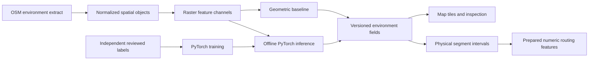

# Environment preferences: proposed design and experiment

Status: pilot acquisition and source inspection available, 2026-11-02.
A bounded OSMnx feature downloader, Leppävaara pilot configuration, and
[source inspection map](guide.md#environment-source-inspection) are implemented; see
[acquisition commands and limitations](development.md#acquire-environment-pilot-data).
Complete-context validation, fields, models, field overlays, and routing preferences
remain proposed. This document owns the proposed design and experiment protocol; the
[roadmap](roadmap.md#planned-environment-preferences-experiment) owns outstanding
work and delivery gates. Existing capabilities remain in the [guide](guide.md).

The [first acquisition report](archive/history/2026-11-02-environment-acquisition.md)
records the 2026-11-02 pilot, checksums, feature counts, and remaining coverage
limitations. It does not establish model quality or complete context coverage.
The [inspection progress report](archive/history/2026-11-02-environment-inspection.md)
records the source-map checks, initial user review, and Leppävaarankatu road-class
calibration case. Class-specific road styling remains planned.

## Objective and first deliverable

Let a runner explore forest surroundings, proximity to water, and traffic
exposure independently, then use supported attributes as route preferences.
The first deliverable is an inspectable forest visualization in one familiar
capital-area region, with water and road context visible at the same locations.
Routing integration follows spatial-field and local-runner validation.

The learning objective is to use PyTorch to estimate surroundings from nearby
entities and test whether learning improves a transparent geometric baseline.
A useful baseline can ship without a learned model if the experiment does not
demonstrate an improvement.

## Spatial meaning and overlapping outputs

Keep mapped objects, estimated surroundings, and personal preferences separate:

| Quantity | Meaning | Initial representation |
| --- | --- | --- |
| Woodland coverage | Mapped woodland footprint, including holes | Source polygons and per-cell area fraction |
| Forest surroundings, F | Degree of wooded surroundings at a location | Continuous score in [0, 1] |
| Water proximity, W | Degree of proximity to a mapped shoreline or waterway | Continuous score in [0, 1] |
| Traffic exposure, T | Exposure proxy derived from nearby roads | Continuous score in [0, 1] |
| User preferences | Tradeoffs between route length and environment attributes | Separate nonnegative routing weights |

F, W, and T do not sum to one. A wooded lakeside location beside a major road
can score highly on all three. Do not subtract traffic from forest surroundings
or assign one winning class per cell. Retain continuous fields; thresholded
contours are display products, not the underlying data model.

Land cover and surroundings have different targets. A path just outside a
woodland polygon may have wooded surroundings. Water proximity does not imply
a view of water or access to its shore. Road-derived exposure does not measure
current traffic, noise, air quality, or safety. The initial feature offers
traffic avoidance as a soft preference; a guarantee of no nearby traffic is
outside this experiment.

## Proposed preparation and delivery boundaries

Environment objects and fields are independent of routing topology. Prepare
them offline; panning and route requests never fetch OSM or run a neural network.
Use bounded spatial reads for tiles and inspection. A missing environment
artifact must leave existing terrain and routing services usable.

Proposed ownership follows the existing [architecture](architecture.md):
`sources/` handles acquisition, a new `environment/` package handles object
normalization and field preparation, `experiments/` owns training/evaluation,
`paths/` joins fields to physical segments, and `api/` plus `web/src/` deliver
the visualization. Shared routing and native code consume prepared features.
Use data-only containers and module-level functions; a PyTorch model may use
`nn.Module` for its parameter lifecycle. Keep PyTorch in an optional experiment
dependency group rather than an interactive-server requirement.

## Source acquisition and geometry

The initial implementation uses OSMnx's feature API and raw response cache.
It retains assembled geometry and source tags without replacing the existing
routing graph. Pyosmium's area assembly over regional `.osm.pbf` files is a
candidate for a later import path, especially if bounding-box discovery omits
large enclosing areas. The initial query does not satisfy the complete-geometry
gate below until independently checked; successful download alone is insufficient.

Reuse OSM acquisition and provenance conventions, with an independent environment
query. The existing runnable-highway extract cannot establish environment
coverage: it excludes forest geometry and many major roads.

- Include `natural=wood` and `landuse=forest`, water areas, waterways, and
  relevant shorelines. Preserve parks and other green areas as distinct evidence;
  a park tag alone is not a forest label.
- Acquire road context independently of pedestrian eligibility, including major
  roads. Preserve road class, speed/lanes where available, and bridge, tunnel,
  layer, access, and service attributes. Missing attributes get explicit masks.
- Retain buildings as a possible contextual feature. Trees and tree rows are
  optional subsequent inputs; omit them explicitly from the initial manifest.
- Assemble complete multipolygon relations and member ways, respecting inner
  rings. Retrieve complete geometries intersecting the analysis region and halo,
  rather than selecting objects only by contained vertices. Record incomplete
  relations and geometry repairs; do not silently use broken areas as labels.
- Preserve source type/ID, tags, geometry, source time, query, bounds, checksums,
  attribution, and licensing. Deduplicate shared objects and avoid double-counting
  overlapping woodland polygons when calculating union coverage.

The initial spatial support is 300 m. Acquire at least that halo around the
display core; enlarge it if feature computation or the model receptive field
requires more context. Track valid support explicitly at boundaries. Every
derived tile must use the same grid origin and full required context before
cropping its core.

A successfully downloaded extract establishes acquisition coverage, not complete
real-world mapping. Store these separately: acquisition/geometry validity,
attribute missingness, independent label validity, and estimated model uncertainty.
Absence of a forest or road tag is not reliable evidence of absence on the ground.

## Grid, features, and geometric baseline

Start with a 10 m EPSG:3067 grid aligned across tiles. Compare a 5 m grid on
narrow paths and woodland edges before deciding the delivered resolution.
The grid must not change pedestrian connectivity or access permissions.

Prepare separate channels for woodland union fraction, woodland coverage within
25/100/300 m, distance to woodland, distance to shorelines/waterways, road
distance and density by class, available road attributes, building coverage,
and validity/missingness masks. Use metric geometry and point-to-line/polygon
distances, not distance to object centroids. Compare input channels through
ablations rather than assuming all of them help.

The first baseline is deliberately reproducible:

- F is mean mapped woodland union coverage in a 100 m disk.
- W is `max(0, 1 - d / 100 m)`, with d the distance to mapped shoreline or
  waterway; keep water-body interiors identifiable in inspection.
- T is the maximum nearby-road influence
  `a(class) * max(0, 1 - d / 300 m)`. Start with amplitudes 1.0 for
  motorway/trunk, 0.8 for primary, 0.6 for secondary, 0.4 for tertiary, and
  0.2 for other motor-vehicle roads. Exclude mapped motor-vehicle prohibitions;
  absent access tags remain an assumption recorded in the configuration.

These are initial proxy definitions, not calibrated probabilities or established
perceptual distances. Save all radii, tag rules, and amplitudes in configuration.
The maximum-road baseline avoids treating duplicated road geometry as increased
exposure; a road-density model is a later comparison. Preserve bridge/tunnel
evidence for review without assuming that grade separation removes exposure.
The baseline describes mapped context and must display that limitation even
where acquisition coverage is valid.

## Labels and missing-data experiment

Choose three nonadjacent familiar study areas within existing prepared coverage,
spanning woodland interiors/edges, waterfront, and major-road corridors. Freeze
their bounds and assign training, validation, and final test areas before model
tuning. Use guard bands at least as wide as the maximum feature/model context,
and prevent shared large source objects from leaking between splits by grouping
them or excluding affected boundary samples.

Initially review 100 locations per split, including confirmed positive and
negative examples for each attribute and overlapping cases. Keep a representative
sample separate from deliberately selected difficult cases. Record coordinates,
review date, evidence/source identity, and per-attribute validity. Use a fixed
rating rubric: 0 absent, 1 low, 2 medium, 3 high. Define wooded surroundings,
water proximity, and road exposure separately with example locations; do not
ask reviewers for a single overall route-quality score. Record disagreements
and unknowns rather than forcing labels. Re-review at least 20% of locations
with a second reviewer where possible; otherwise report the single-reviewer
limitation. Expand the sample if an attribute lacks sufficient positive/negative
examples or model comparisons remain inconclusive.

OSM polygons can provide weak woodland labels, but cannot independently validate
predictions made from those same polygons. Use field review or independently
verified imagery/land-cover evidence, with dates and resolution recorded. Finer
output grids do not create finer evidence from a coarse source.

For missing-data recovery, remove whole objects or contiguous mapped patches
from model inputs while retaining independent evaluation labels. Test both
artificial omissions and naturally incomplete mapping. Removing isolated raster
pixels is insufficient. Keep this task separate from reproducing known OSM
geometry: nearby tags alone cannot recover arbitrary missing forests.

## PyTorch model comparisons

Run comparisons in order, with identical splits, targets, and feature support:

1. Geometric baseline, including its support masks.
2. Small per-cell MLP using prepared multiscale summaries, to test whether learned
   feature combinations help without learned spatial aggregation.
3. Small CNN or U-Net over raster patches, to learn spatial arrangement. Record
   the effective receptive field and avoid patch/tile padding artifacts.
4. Optional heterogeneous GNN if raster errors motivate entity-based aggregation.
   Use query cells, woodland polygons, water entities, and road segments as node
   types; relations carry distance, containment/overlap, and structural evidence.
   Query cells must cover the area, not only existing routing edges.

Use separate output heads for each attribute. Continuous rubric ratings can be
normalized to [0, 1] and trained with a masked regression loss. For explicitly
binary labels, use independent logits and masked `BCEWithLogitsLoss`, not a
softmax. Normalize losses per observed attribute before combining them; unknown
targets contribute no supervised loss. Skip batches with no valid targets.

For binary predictions evaluate calibration separately; a sigmoid value is not
an uncertainty estimate. Report per-attribute label counts, model disagreement
if using multiple seeds, and performance by evidence completeness. Preserve
coverage masks regardless of predicted confidence. Add imagery only as a
separately evaluated input experiment with acquisition/licensing defined first.

## Visualization and inspection

The existing application now includes a separate source inspection page with
independent source layers and overlap/tag inspection; see the guide above.
For the next field experiment, export static baseline panels and georeferenced fields for review; then
add independently toggleable forest, water, traffic, source-outline, and unknown
layers. Use a forest heatmap, water contours, and traffic hatching or outlines
so overlaps remain visible. Include legends and baseline/model comparison with
matched scales. Inferred values must be distinguishable from source geometry.

Click inspection should show all attribute scores, mapped source objects,
distances/coverage summaries, validity, model/source versions, and whether the
value is a mapped-context baseline or learned estimate. Keep acquisition and
training details in developer inspection rather than ordinary preference controls.
Check source holes, tile seams, zoom changes, keyboard/mobile use, rapid panning,
cancellation, stale responses, and combinations with existing terrain/path layers.

## Experiment evidence and decision criteria

Save configuration, source and label manifests, split assignments, feature/grid
versions, code revision and dirty-state identity, dependency versions, training
seeds/checkpoints, machine, runtime, and peak memory. Store generated outputs in
a dedicated `artifacts/environment-preferences/` run directory. Write dated
reports under `docs/archive/history/` when experiments actually run; no result
is claimed by this plan.

Report per-attribute MAE against normalized ratings, thresholded precision/recall
and IoU where binary labels are valid, and calibration where probabilities are
claimed. Evaluate forest boundaries, mixed environments, and missing-context
cases separately. Report representative-area and challenge-set results separately.
Show baseline/model differences and source evidence at saved review locations.
Use spatial-block uncertainty estimates where sample size permits; do not count
neighboring cells as independent evidence of improvement.

Choose architectures and thresholds using validation data only. Before opening
the final test results, freeze the practical improvement margin and acceptable
regression limits from reviewer disagreement and validation observations. Promote
a learned model only if it improves the intended target over the baseline across
spatial holdouts, preserves useful overlaps, and has acceptable preparation cost.
Otherwise retain the baseline and document failures. Report every trained seed,
not only the best run.

Measure preparation time, artifact size, offline inference memory/time, cold/warm
tile and inspection p50/p95 latency, and browser interaction on recorded hardware.
Set numerical delivery budgets from the first baseline measurements before
expanding coverage. Field generation and tile delivery need separate budgets.

## Later routing integration

After field review, sample F/W/T into ordered physical-segment intervals with
validity/support and artifact identity. Handle woodland boundaries and partial
segments explicitly; refine sampling or intersect geometry where coarse cells
miss narrow features. Follow the existing projected/geodesic chainage contract
in [prepared data](reference/prepared-data.md#published-graph-and-measurements).
Both directed arcs share environmental context initially; access remains a
separate policy. Repeated traversals incur repeated exposure costs.

An initial length-equivalent cost is:

\[
C(e)=\int_e [1+w_f(1-F(s))+w_w(1-W(s))+w_tT(s)]\,ds,
\qquad w_f,w_w,w_t\geq0.
\]

Here ds is graph-distance chainage in metres and the weights are dimensionless.
This adds nonnegative penalties and preserves distance as a lower bound; it
does not define the full existing hill/shape objective. Review native/reference
cost integration and admissible heuristics before enabling controls. Prove that
all environment weights Off reproduce existing routes and costs.

Do not substitute zero for unknown fields. Before enabling each preference,
choose and document either a validated imputation policy with separate unknown
reporting or a supported-coverage restriction. Until that decision passes review,
keep the affected control unavailable. Show route coverage and environment
summaries separately from preference strength; lack of evidence must not become
an apparent quiet or forest-free area.

Version the field artifact by source, feature rules, grid, and model/checkpoint.
Version its segment join by network identity and sampling rules. Extend network
and numeric artifacts together, preserving segment order, bounded loading,
partial-endpoint semantics, and native/reference equivalence. Calibrate individual
preferences and combinations against Off using saved familiar routes; report
length, exposure, unknown fraction, expanded states, latency, and runner judgments.

## Documentation transition

As stages ship, move delivered usage to the guide, component boundaries to the
architecture, configuration/commands to development, artifact contracts to
prepared-data references, and accepted cost definitions to routing mathematics.
Remove completed tasks from the roadmap, retaining outstanding runner acceptance
explicitly. Keep this proposal clearly marked or archive it once superseded.

## Technical references

- [OSMnx feature API](https://osmnx.readthedocs.io/en/stable/user-reference.html#module-osmnx.features)
  for pilot acquisition and [Pyosmium area processing](https://docs.osmcode.org/pyosmium/latest/reference/File-Processing/)
  for the candidate regional-file path.
- [OSM forest tagging](https://wiki.openstreetmap.org/wiki/Tag:landuse=forest)
  and [multipolygon geometry](https://wiki.openstreetmap.org/wiki/Relation:multipolygon).
- [PyTorch BCEWithLogitsLoss](https://docs.pytorch.org/docs/2.9/generated/torch.nn.BCEWithLogitsLoss.html)
  for independent binary targets.
- [PyTorch Geometric heterogeneous learning](https://pytorch-geometric.readthedocs.io/en/latest/notes/heterogeneous.html)
  for the optional entity-based model.
